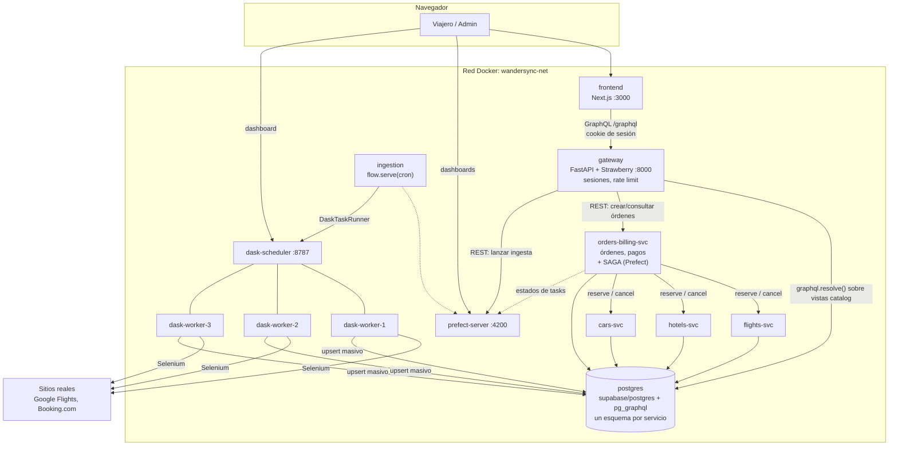
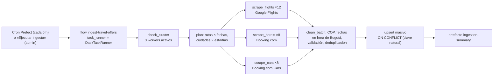
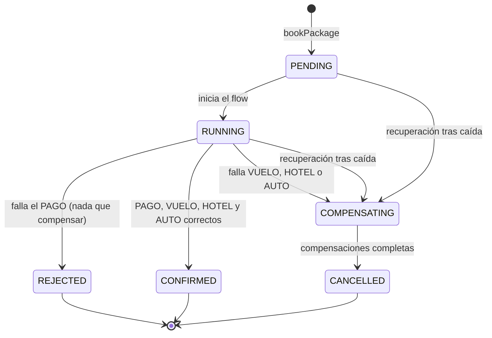
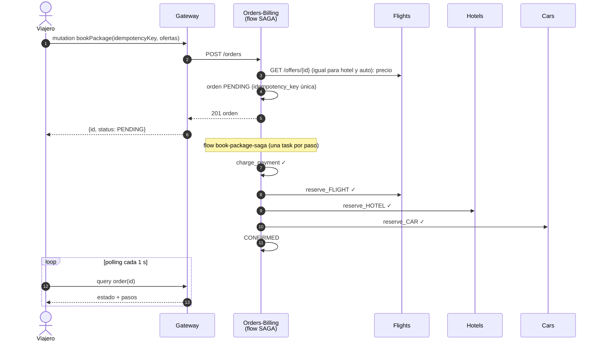
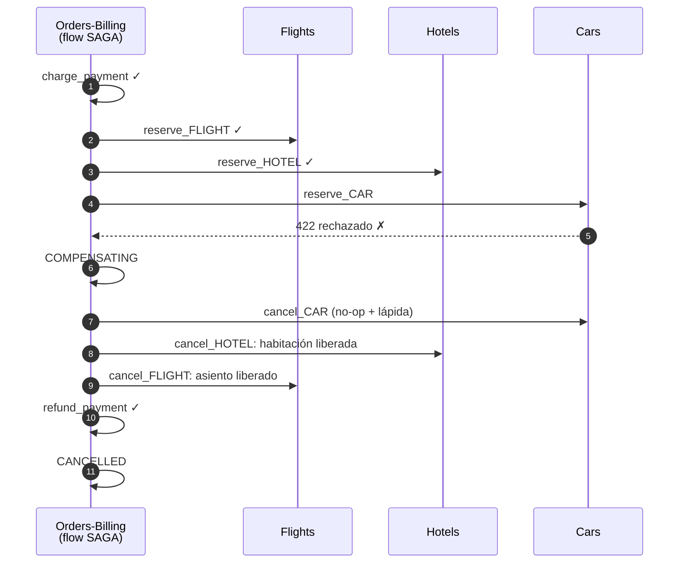
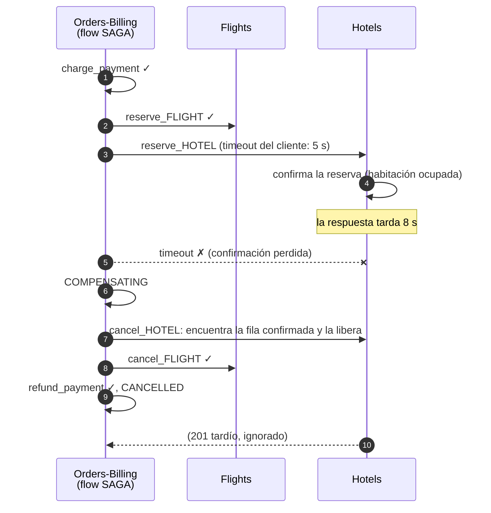
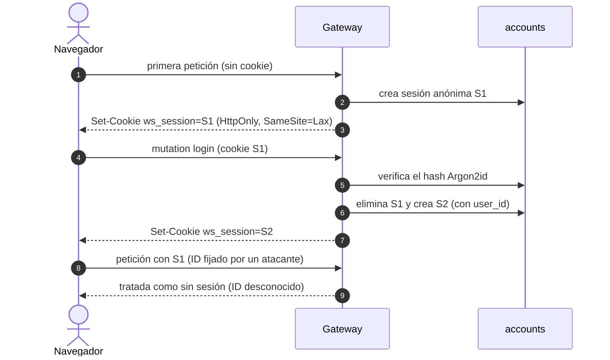

# WanderSync Travel Solutions: Documento Técnico de Arquitectura

| | |
|---|---|
| **Asignatura** | Patrones Arquitectónicos Avanzados, Parcial Práctico del Segundo Corte |
| **Autor** | Santiago Prieto |
| **Fecha** | 10 de octubre de 2026 |
| **Repositorio** | `wandersync/` (Git, una entrega por etapa con su evidencia en `evidence/`) |

---

## 1. Resumen

WanderSync vende paquetes turísticos dinámicos (vuelo + hotel + auto) en una sola reserva. El rediseño resuelve dos problemas del sistema anterior:

1. **Reservas huérfanas.** Antes se cobraba al cliente y se reservaba el vuelo, pero si el hotel o el auto fallaban en la red la orden quedaba en un estado indeterminado. Ahora la reserva es una **SAGA orquestada por Prefect**: cualquier fallo dispara **compensaciones automáticas en orden inverso**, y las compensaciones son idempotentes y seguras ante confirmaciones perdidas y caídas del orquestador.
2. **Cuellos de botella al sincronizar tarifas.** Ahora la extracción de precios de sitios reales (**Google Flights, Booking.com y Booking.com Cars**) corre en un **clúster Dask de 3 workers**, orquestado y observado por **Prefect** con políticas explícitas de reintento. Los servicios de cara al cliente nunca se bloquean.

Todo el sistema se despliega con un solo comando (`docker compose up -d`): 13 contenedores, todos locales. El frontend solo habla con un **API Gateway GraphQL**, que lee el catálogo mediante el GraphQL nativo de PostgreSQL (`pg_graphql`, el mismo motor de Supabase) sin over-fetching.

| Tecnología obligatoria | Uso en la solución |
|---|---|
| Docker Compose | 13 contenedores, healthchecks y arranque ordenado (`service_healthy`) |
| GraphQL | Gateway Strawberry (Python) como única entrada, más `pg_graphql` en la base de datos |
| Patrón SAGA | Orquestación con compensaciones en orden inverso, idempotencia y recuperación ante caídas |
| Dask | Scheduler y 3 workers que ejecutan el scraping con Selenium, la limpieza y la carga masiva |
| Prefect | Flow de ingesta (cron, reintentos, artefactos) y flow de la SAGA (una task por paso y por compensación) |

---

## 2. Arquitectura general



| Contenedor | Rol | Puerto en el host |
|---|---|---|
| `frontend` | UI en español (Next.js, Apollo Client) | 3000 |
| `gateway` | API GraphQL, autenticación, sesiones, rate limiting | 8000 |
| `flights-svc`, `hotels-svc`, `cars-svc` | Participantes de la SAGA: ofertas, reservas, inventario | interno |
| `orders-billing-svc` | Órdenes, pagos (simulados), orquestador SAGA (flow Prefect) | interno |
| `ingestion` | Flow Prefect de ingesta servido con cron | interno |
| `dask-scheduler`, `dask-worker-1..3` | Clúster de cómputo distribuido (Chromium + Selenium en cada worker) | 8787 (dashboard) |
| `prefect-server` | API y UI de Prefect | 4200 |
| `postgres` | `supabase/postgres` con `pg_graphql` | interno |

Los puertos publicados escuchan solo en `127.0.0.1`. Las bases de datos y los microservicios internos no se exponen.

---

## 3. Decisiones de arquitectura y justificación

| # | Decisión | Alternativas descartadas | Justificación |
|---|---|---|---|
| ADR-01 | SAGA **orquestada** con un flow Prefect dentro de `orders-billing-svc` | Coreografía con RabbitMQ; contenedor orquestador separado | El enunciado exige Prefect para la SAGA. La orquestación centraliza el control de compensaciones y las hace visibles en la UI. El dueño de la orden es el orquestador natural, y así hay un contenedor menos. |
| ADR-02 | El gateway traduce la selección GraphQL del cliente a un documento **`pg_graphql`** | SQL a mano por campo; Hasura o PostGraphile | Usa el GraphQL nativo de la base de datos (§3.3 del enunciado). Una búsqueda completa cuesta **un** viaje a la base de datos y solo se leen las columnas pedidas (sin over-fetching). No añade contenedores. |
| ADR-03 | Sesiones en PostgreSQL y rate limits en la memoria del gateway | Redis; `limit_req` de nginx | Mínimo de contenedores. El límite debe distinguir operaciones GraphQL (`login` frente a `cities`), y un proxy solo vería `/graphql`. Techo: un solo gateway. |
| ADR-04 | Una misma imagen para el scheduler, los workers y el runner, más `DaskTaskRunner` de `prefect-dask` | Imágenes separadas; un `Client` manual dentro de cada task | Dask exige las mismas versiones en todos sus nodos, y así cada task se ve a la vez en Prefect y en Dask. |
| ADR-05 | También se compensa **el paso que falló**, y la cancelación es *tombstone-safe* | Compensar solo los pasos confirmados | Un timeout significa «resultado desconocido»: el paso pudo confirmarse (la reserva huérfana del enunciado). La lápida hace inofensiva una reserva que llega tarde y permite recuperar compensándolo todo. |
| ADR-06 | Las compensaciones reintentan hasta tener éxito (5 reintentos con backoff de 1, 2, 4, 8 y 16 s) | Marcar la orden como fallida para revisión manual | La rúbrica exige compensaciones automáticas, sin intervención manual. |
| ADR-07 | Inventario como contador por oferta, fijado al insertar y nunca sobrescrito por la ingesta | Unidades individuales con retenciones y TTL | Es lo más simple que mantiene el demo funcional y aun así impide la sobreventa (`CHECK >= 0` más un decremento condicional). |
| ADR-08 | Vuelo solo de ida, más hotel y auto, para 1 viajero | Ida y vuelta, varios viajeros | Reduce a la mitad el volumen de scraping, dado el plazo. Queda documentado como limitación. |
| ADR-09 | Solo la imagen `supabase/postgres`, no el stack completo de Supabase | Supabase self-hosted (unos 10 contenedores); Supabase en la nube | Mismo motor `pg_graphql`, un solo contenedor, todo local (decisión D-002). |

---

## 4. Ingesta distribuida: Dask y Prefect



- **Fuentes reales**, elegidas mediante una prueba en vivo dentro de la imagen de los workers:

  | Categoría | Sitio | Cómo se extrae |
  |---|---|---|
  | Vuelos | Google Flights | La frase completa del `aria-label` de cada resultado |
  | Hoteles | Booking.com | `data-testid="property-card"` |
  | Autos | Booking.com Cars | Se ancla en el logo del proveedor |

  El scraper reutiliza el código Selenium del taller 1 (`PA-Taller1`): configuración del driver, flags anti-detección, scroll para carga perezosa y parseo de precios en COP.
- **Distribución:** cada `scrape_*`, `clean_*` y `upsert` es una task de Prefect enviada con `.submit()`. `DaskTaskRunner` la ejecuta como tarea Dask en uno de los 3 workers (`--nthreads 1`, un Chromium por worker). Una ejecución tiene 28 tareas de scraping y tarda unos 2,5 minutos.
- **Reintentos explícitos:**

  | Task | Política |
  |---|---|
  | `scrape_*` | 3 reintentos, backoff exponencial de 10, 20 y 40 s, jitter 0,5 |
  | `upsert` | 2 reintentos, 5 s |
  | `check_cluster` | 3 reintentos, 5 s |

  Si una fuente sigue caída tras sus reintentos, sus tasks terminan en `Failed`, pero el flow carga lo demás (**éxito parcial**).
- **Escritura directa** en la base de datos con GraphQL (§3.3 del enunciado). La escritura usa el rol `ingestion_svc`, que solo puede insertar ofertas y actualizar precio, horarios y `scraped_at`. Una nueva extracción **no puede** sobrescribir el inventario de reservas en curso.
- **Observabilidad:** la UI de Prefect muestra el estado, los reintentos y los logs de cada task, más un artefacto con filas extraídas, válidas, rechazadas, insertadas y actualizadas. El dashboard de Dask muestra el task stream por worker.

---

## 5. Persistencia y API GraphQL

**Base de datos por servicio** dentro de un solo PostgreSQL: un **esquema y un rol de login por dueño**. Ningún rol puede leer ni escribir el esquema de otro (evidencia AC-03.3: 7 accesos cruzados denegados).

| Esquema | Dueño | Contenido |
|---|---|---|
| `flights`, `hotels`, `cars` | `*_svc` | Ofertas y reservas (`order_id` único, que actúa como registro de idempotencia) |
| `orders` | `orders_svc` | Órdenes, pagos y la bitácora de pasos `saga_steps` |
| `accounts` | `gateway_svc` | Usuarios (hash Argon2id) y sesiones (`sha256` del token) |
| `catalog` | superusuario | **Vistas de solo lectura** sobre las ofertas: el modelo de lectura (CQRS) que expone `pg_graphql` |

**Sin over-fetching (FR-12).** El resolver de `packageAvailability` recorre la selección del cliente y arma un único documento `pg_graphql` con solo los campos pedidos:

```text
cliente pide:  flights(limit: 3) { priceCop }
gateway envía: { flights: flightOffersCollection(first: 3, filter: {...}) { edges { node { id priceCop } } } }
```

Una búsqueda completa (vuelos, hoteles, autos y paquete más barato) cuesta **un** viaje a la base de datos. Las relaciones `Order.flight/hotel/car` usan **DataLoaders por petición**: listar 3 órdenes con sus ofertas cuesta 3 consultas, no 9 (sin N+1). El rol del gateway tiene `search_path = catalog`, así que `pg_graphql` **no puede** exponer `accounts` (probado: `usersCollection` no existe para ese rol). Un lote de 20 búsquedas con alias en una sola petición se rechaza antes de tocar la base de datos.

---

## 6. Patrón SAGA

### 6.1 Máquina de estados de la orden



Pasos hacia adelante: **PAGO → VUELO → HOTEL → AUTO** (el cobro va primero, como en el escenario del enunciado). Las compensaciones corren en orden inverso: cancelar auto → cancelar hotel → cancelar vuelo → reembolso.

### 6.2 Camino feliz



### 6.3 Compensación: falla el auto (ejemplo del enunciado)



### 6.4 Confirmación perdida: timeout en el hotel (la «reserva huérfana»)



**¿Por qué no puede quedar una reserva huérfana?**

- Cada participante guarda **una fila por `order_id`** (única). `cancel` libera esa fila y devuelve el inventario. Si `reserve` aún no llegó, `cancel` escribe una **lápida** `CANCELLED`.
- `reserve` inserta con `ON CONFLICT (order_id) DO NOTHING` y solo descuenta inventario si su inserción ganó. Un `reserve` que llega después de su cancelación no hace nada (410).
- Las dos operaciones son transacciones locales con decremento condicional (`... WHERE disponible > 0`). El resultado es el mismo en cualquier orden de llegada.

### 6.5 Idempotencia, reintentos y recuperación

| Mecanismo | Implementación |
|---|---|
| Idempotencia de la orden | `orders.idempotency_key` única. Tres peticiones concurrentes con la misma clave producen **una** orden y **una** SAGA (AC-06.8). |
| Idempotencia por paso | `payments.order_id` es la llave primaria y `*_reservations.order_id` es única. Repetir cualquier llamada es inofensivo. |
| Reintento de compensaciones | Las tasks `cancel_*` y `refund_payment` tienen 5 reintentos con backoff. Probado con un fallo inyectado en cada cancelación (AC-06.7). |
| Caída del orquestador | Al arrancar, `orders-billing-svc` busca órdenes en `PENDING/RUNNING/COMPENSATING` y ejecuta el flow `recover-unfinished-order`, que compensa todo (seguro gracias a las lápidas). Probado con `SIGKILL` justo con el pago cobrado, el vuelo reservado y el hotel confirmado (AC-06.10). |
| Conciliación | `scripts/reconcile.sql` cruza todos los esquemas: 0 órdenes sin estado final, 0 reservas huérfanas, 0 cobros retenidos (AC-06.9). |

---

## 7. Ciberseguridad por diseño



| Requisito | Implementación | Evidencia |
|---|---|---|
| Session fixation | El ID se **regenera** al hacer login o registro y se destruye en logout. Nunca se adoptan IDs que el servidor no emitió. Solo se guarda el `sha256` del token. Cookie `HttpOnly` y `SameSite=Lax`. | AC-08.2, AC-08.3 |
| Hashing de contraseñas | **Argon2id** (`argon2-cffi`, t=3, m=64 MiB, p=4, perfil RFC 9106). Hash ficticio para correos inexistentes (tiempo constante). Errores genéricos sin enumeración de usuarios. | AC-08.1 |
| Rate limiting | Por operación GraphQL: login 5/min por IP y 10 cada 15 min por correo; registro 3/min por IP; `bookPackage` (checkout y pago) 5/min por usuario; ingesta 2/min; 120/min por IP en general. Responde **429 con `Retry-After`** y un error `RATE_LIMITED`. | AC-08.4 |
| Autorización | Cada usuario solo ve sus órdenes. La simulación de fallos y la ingesta manual son solo para administradores. CORS restringido al frontend. Cabeceras de seguridad. | AC-08.5 |
| Cadena de suministro | `pip-audit` en los 6 lockfiles de Python (0 vulnerabilidades). `npm audit` encontró **1 crítica** (`next` 16.3.5, RCE en `next/og`, heredada del taller SAGA) y 5 altas; se corrigieron actualizando a `next` 16.3.8 y eliminando la cadena de eslint que no se usaba. Resultado: **0**. | AC-08.6 |
| Mínimo privilegio | Un rol de base de datos por servicio. Contenedores sin root. Puertos solo en localhost. | AC-03.3, AC-02.4 |

---

## 8. Despliegue y operación

```bash
cp .env.example .env
docker compose up -d          # o ./start.sh (agrega --build --wait e imprime las URLs)
```

- **Arranque:** 13 contenedores en unos 60 s, todos con healthcheck. Cada servicio arranca cuando sus dependencias están sanas (`depends_on: condition: service_healthy`). Las migraciones y los datos semilla se aplican solos sobre un volumen vacío.
- **Configuración:** todo pasa por variables de entorno (`.env.example`). No hay secretos en Git.
- **Consumo:** unos 1,6 GB de RAM en total durante la ingesta, que es la parte más pesada (Chromium en los workers).
- **Pruebas:**
  - `scripts/e2e_all.sh` ejecuta toda la regresión: ingesta real, pruebas del parser, participantes, los 8 casos SAGA, conciliación, gateway y seguridad, y E2E con navegador.
  - `scripts/simulate_saga.py` ejecuta solo los casos SAGA.

---

## 9. Verificación frente a la rúbrica

| Criterio (peso) | Cómo se cumple | Evidencia principal |
|---|---|---|
| Arquitectura y Dockerización (15 %) | Un solo `docker compose up`, microservicios aislados con esquema y rol propios, healthchecks, clon limpio verificado | `evidence/stage-02`, `evidence/stage-10` |
| API Gateway GraphQL y persistencia (15 %) | Gateway como única entrada, `pg_graphql`, 1 viaje a la base de datos por búsqueda, DataLoaders, contrato verificado | `evidence/stage-07`, `evidence/stage-03` |
| SAGA y consistencia (25 %) | Camino feliz, compensación en cada punto de fallo, timeout, compensación con reintentos, caída del orquestador, idempotencia, conciliación | `evidence/stage-06`, `evidence/stage-09` |
| Dask y Prefect (25 %) | Scraping real en 3 workers, reintentos con backoff, éxito parcial, cron, artefactos, flow SAGA visible | `evidence/stage-04`, `evidence/stage-06` |
| Ciberseguridad (20 %) | Session fixation, Argon2id, rate limiting 429, auditoría de dependencias con remediación | `evidence/stage-08` |

Cada etapa tiene un informe de aprobación (`evidence/gate-N/GATE.md`) con criterios de aceptación, resultado PASS/FAIL, evidencia y el comando para reproducirla.

---

## 10. Limitaciones conocidas y trabajo futuro

- **Scraping real:** los sitios pueden cambiar su HTML o bloquear el scraper. El fallo queda visible en Prefect y el catálogo base mantiene el sistema operativo. Las ofertas extraídas cubren el plan de ingesta (+7 y +14 días, 3 noches). Las demás fechas usan el catálogo base, que la UI etiqueta como tal.
- **Inventario simulado** para las ofertas extraídas (5 unidades), porque los sitios no publican existencias.
- **Una sola réplica** del gateway (rate limits en memoria) y de orders-billing (la recuperación asume que no hay otra instancia ejecutando SAGAs). Para escalar se necesitarían contadores compartidos y un lease por orden.
- **Pago simulado** y vuelo solo de ida para 1 viajero (ADR-08).
- **Cookies sin `Secure`** porque el demo usa HTTP en localhost. Detrás de TLS se activa con `COOKIE_SECURE=true`.

## 11. Reutilización de trabajos previos

| Origen | Qué se reutilizó |
|---|---|
| `PA-Taller1` | Scraper Selenium (configuración del driver, anti-detección, scroll, parseo de precios) y el Dockerfile con Chromium |
| `Taller-PatronSaga` | Patrón de flow Prefect con una task por paso, estructura de los servicios FastAPI, frontend (Dockerfile, componentes UI y tokens de estado) |
| `Taller-DASK` | Topología del clúster (scheduler y 3 workers) y la tarea `check_cluster` con reintentos |
| `Taller-GraphQL` | Estilo del contrato SDL y el patrón de DataLoaders anti N+1 |
| `primer-parcial` | Flujo de entrega por etapas con aprobación y evidencia, y migraciones con roles y RLS |
