# WanderSync — Design (Stage 01)

Contract that every later stage implements. Traces to `requirements.md` §4 (use cases) and §5 (FR/NFR). If code and this document disagree, the code is wrong until this document is formally reopened (`requirements.md` §1.2).

Decisions referenced as `D-xxx` live in `requirements.md` §11; design-level decisions made here are `ADR-xx` (§9 of this document).

---

## 1. Components & deployment

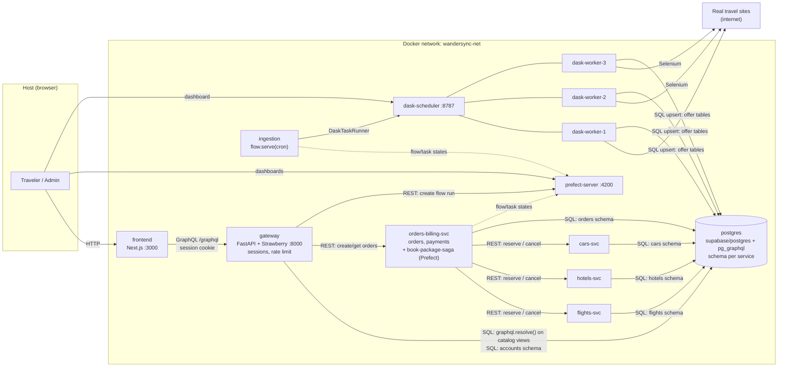

Solid arrows = synchronous calls. Dotted = telemetry to Prefect.

### 1.1 Containers

| Container | Image | Host port | Depends on (healthy) |
|---|---|---|---|
| `postgres` | `supabase/postgres:15.14.1.170` | — | — |
| `prefect-server` | `prefecthq/prefect:3.8.6-python3.12` | 4200 | — |
| `dask-scheduler` | `./ingestion` image | 8787 (dashboard) | — |
| `dask-worker-1..3` | `./ingestion` image (Chromium + Selenium) | — | `dask-scheduler` |
| `ingestion` | `./ingestion` image | — | `postgres`, `prefect-server`, `dask-scheduler` |
| `flights-svc`, `hotels-svc`, `cars-svc` | `./services/<name>` | — | `postgres` |
| `orders-billing-svc` | `./services/orders-billing` | — | `postgres`, `prefect-server`, 3 participants |
| `gateway` | `./services/gateway` | 8000 | `postgres`, `orders-billing-svc`, `prefect-server` |
| `frontend` | `./frontend` (Stage 09) | 3000 | `gateway` |

13 containers total once the frontend exists (12 through Stage 08). Everything except the scraped sites is local (D-002).

Scheduler, workers and ingestion runner share **one image** so Dask client/scheduler/worker versions always match and workers can unpickle the flow's task functions (ADR-04).

Inside the network every FastAPI service listens on `:8000`; only the gateway is published.

---

## 2. Order state machine (shared contract)

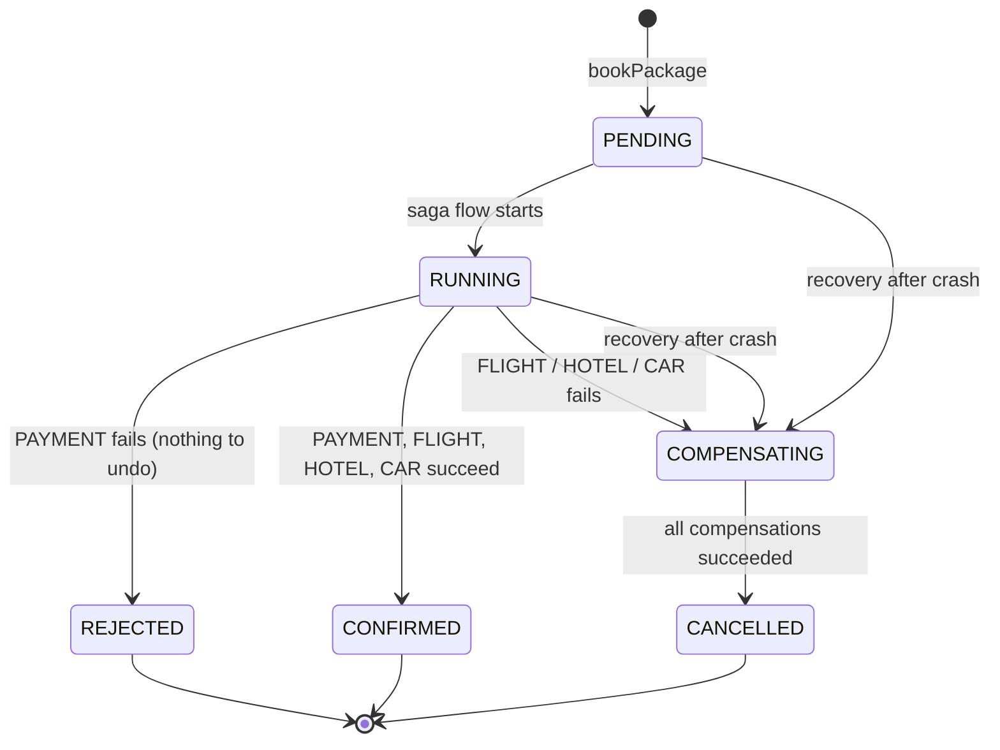

- Terminal states: `CONFIRMED`, `CANCELLED`, `REJECTED`. No other state is ever final (FR-35, NFR-04).
- `COMPENSATING` never ends in failure: compensation tasks retry with backoff until they succeed (FR-36, ADR-06).

---

## 3. SAGA — orchestration with Prefect

Order of forward steps (Q-07 a): **PAYMENT → FLIGHT → HOTEL → CAR**. Compensations run in strict reverse order over the steps that **may** have taken effect (ADR-05).

| Forward step | Owner | Forward call | Compensation |
|---|---|---|---|
| PAYMENT | orders-billing (local) | charge (mock) | refund |
| FLIGHT | flights-svc | `POST /reservations` | `POST /reservations/{order_id}/cancel` |
| HOTEL | hotels-svc | `POST /reservations` | `POST /reservations/{order_id}/cancel` |
| CAR | cars-svc | `POST /reservations` | `POST /reservations/{order_id}/cancel` |

Prefect flow `book-package-saga`, flow-run name = order id. One task per forward step and per compensation, so every rejection is a visible **Failed** task followed by green compensation tasks in the Prefect UI.

### 3.1 Happy path (AC-06.1)

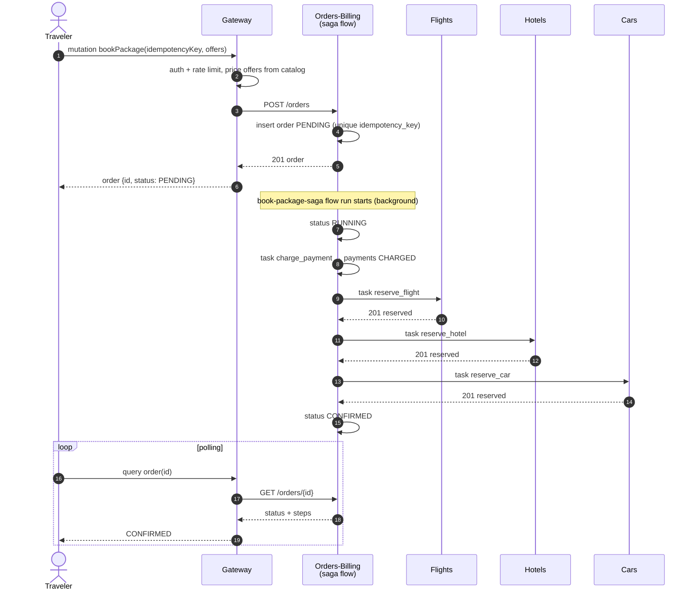

### 3.2 Payment fails (AC-06.2)

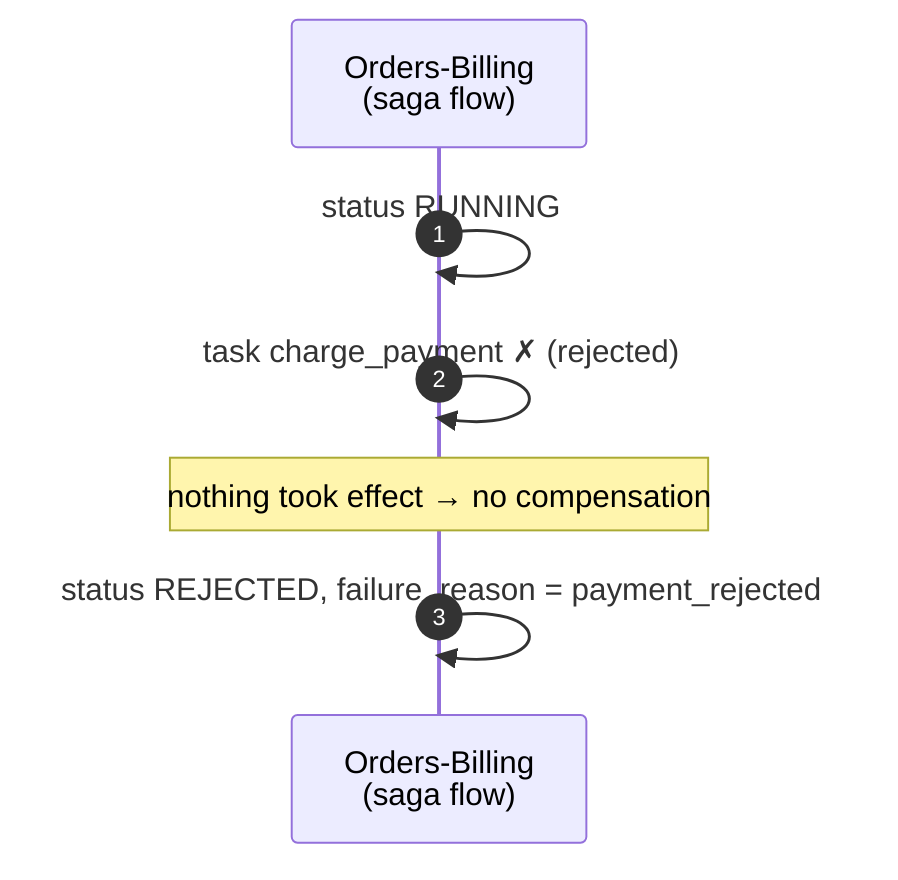

### 3.3 Flight fails (AC-06.3)

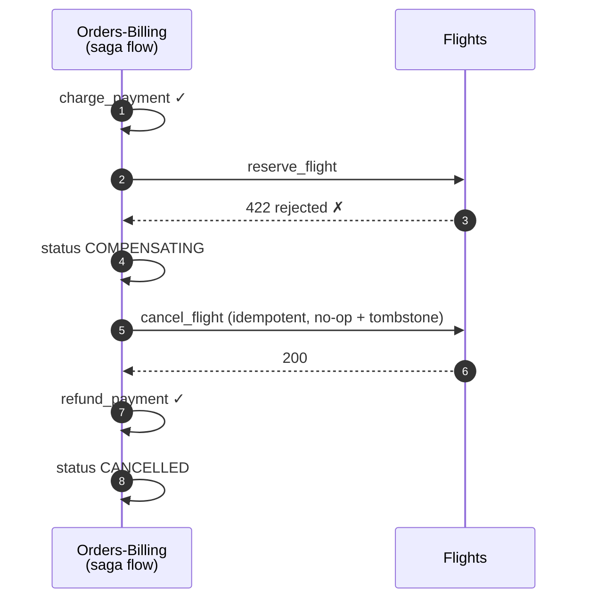

The failed step itself is also compensated: a rejection may still have been a partial/lost success in real life (and is a guaranteed no-op otherwise) — see ADR-05.

### 3.4 Hotel fails (AC-06.4)

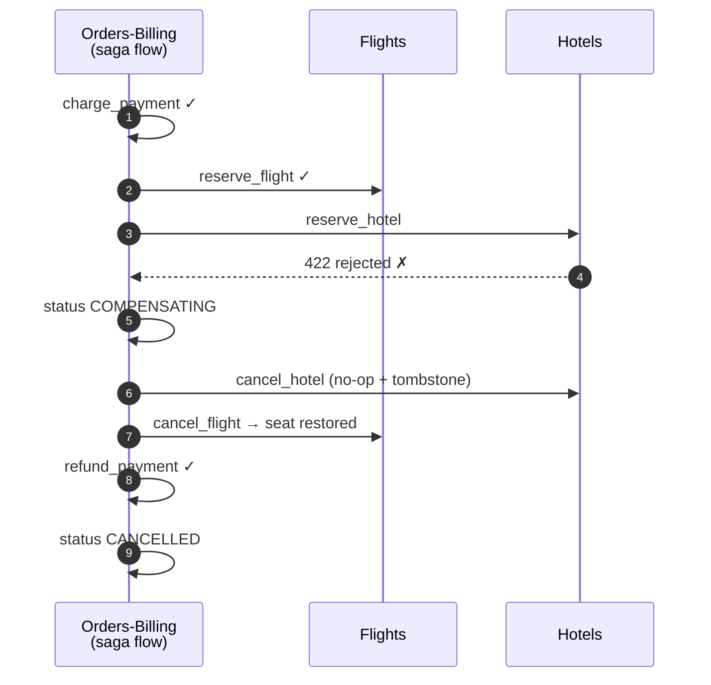

### 3.5 Car fails — the brief's example (AC-06.5)

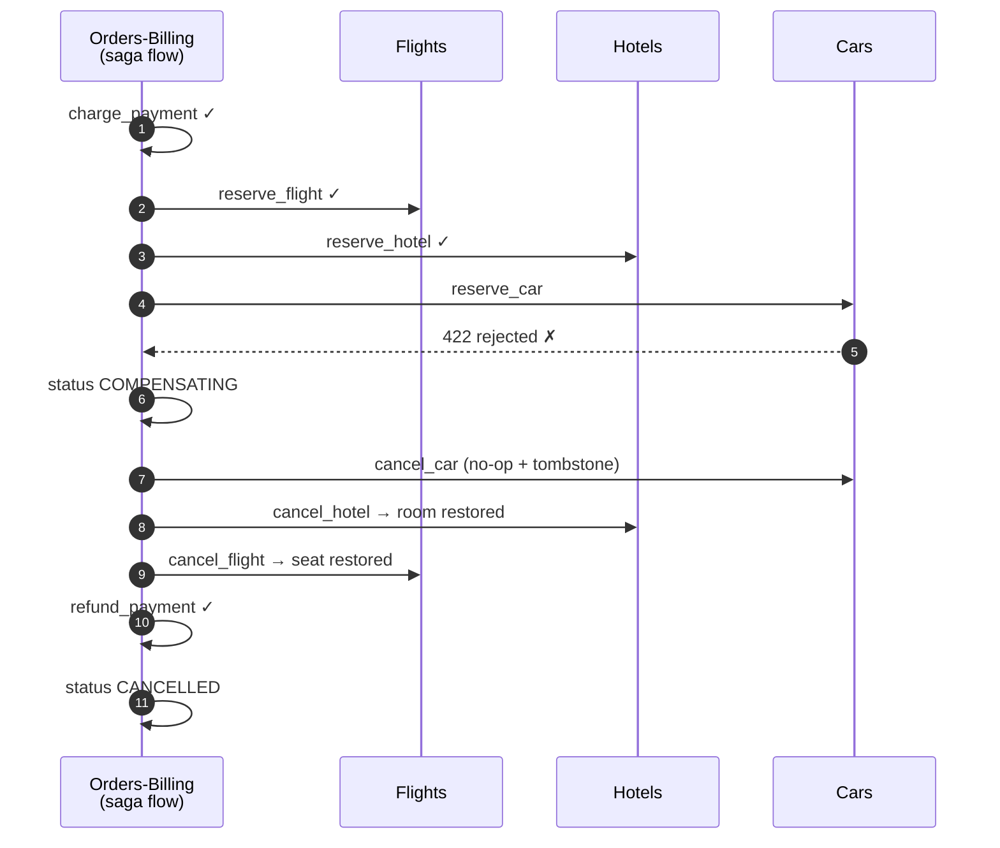

### 3.6 Lost confirmation / timeout at hotel (AC-06.6) — the orphan-booking scenario

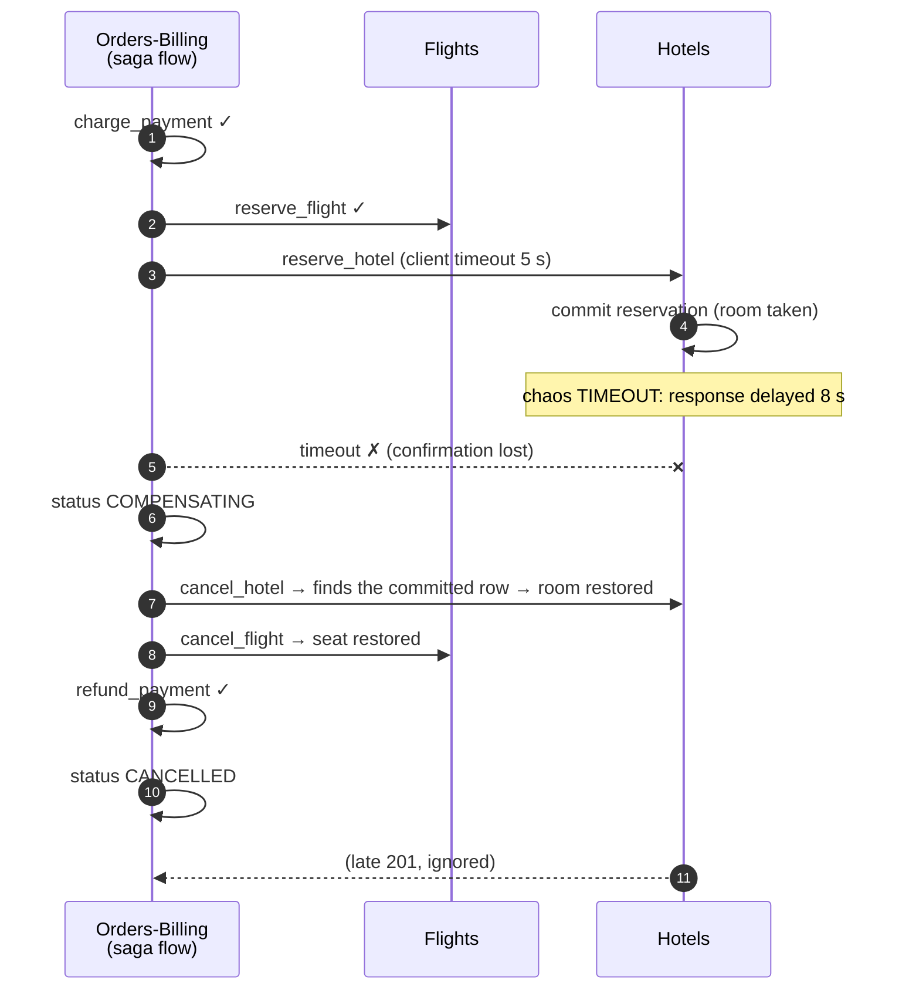

Why no orphan is possible:

- Reservation rows are keyed by `order_id` (unique). `cancel` turns an existing row into `CANCELLED` and restores inventory, or — if the forward call hasn't committed yet — inserts a `CANCELLED` **tombstone**.
- `reserve` inserts with `ON CONFLICT (order_id) DO NOTHING`, and only decrements inventory if its insert won. So a reserve that arrives after its own cancel does nothing.
- Both run in one DB transaction per call, with the inventory row locked (`UPDATE … WHERE available > 0`), so the outcome is the same whatever the interleaving.

### 3.7 Compensation fails transiently (AC-06.7)

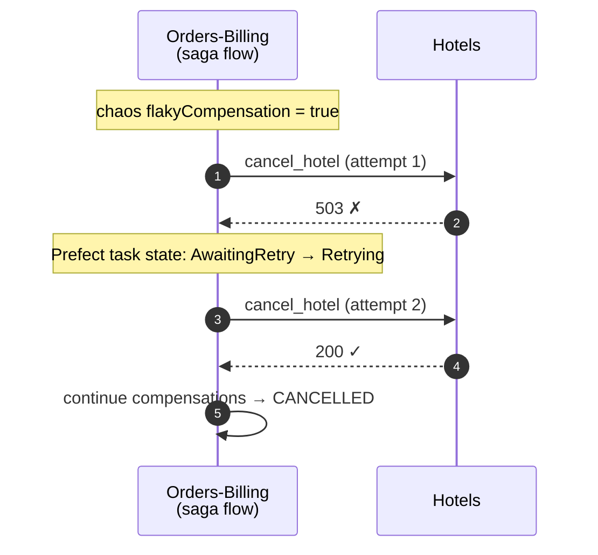

### 3.8 Idempotent retry (AC-06.8)

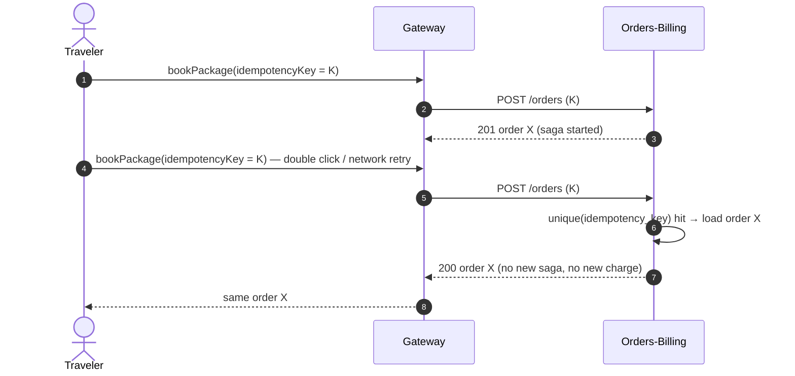

Idempotency layers: (1) `orders.idempotency_key` unique; (2) `payments.order_id` primary key; (3) `reservations.order_id` unique in every participant. Replaying any single call is safe on its own, not only the whole request.

### 3.9 Orchestrator crash recovery (Q-24, T06.7)

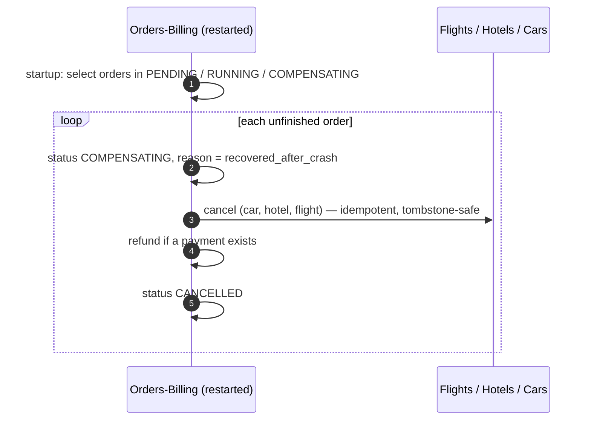

Recovery always compensates (never resumes forward): simplest correct choice, and the user answered "always try to compensate orders on failure" (Q-24). Because every compensation is idempotent and safe when the forward step never happened, recovery doesn't need to know which steps finished.

### 3.10 Retry policies (saga)

| Task | Retries | Delay | Retries on |
|---|---|---|---|
| `charge_payment` | 0 | — | — (local, deterministic) |
| `reserve_flight/hotel/car` | 1 | 2 s | transport errors and 5xx only — never on 409/422 business rejections, never on client timeout (a timeout is treated as failure and compensated) |
| `cancel_*`, `refund_payment` | 5 | exponential 1, 2, 4, 8, 16 s | any error |

Step delay (NFR-07): every task sleeps `SAGA_STEP_DELAY_SECONDS` (default 1.5 s, `0` for automated tests) so the frontend tracker and Prefect UI show each transition.

---

## 4. Data model

One Postgres database, one schema + one login role per owner (Q-05 a, NFR-03). A role can't touch another schema (AC-03.3).

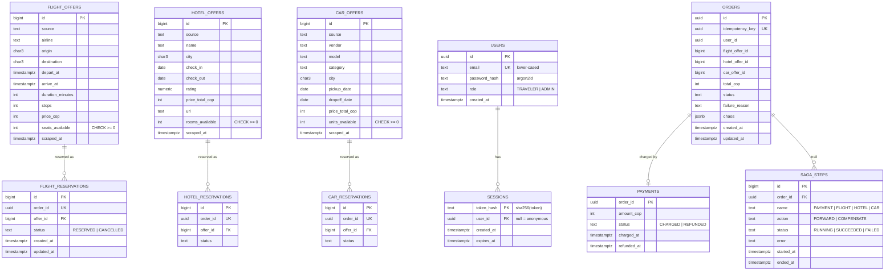

### 4.1 Schemas and roles

| Schema | Tables / views | Owner role (RW) | Other grants |
|---|---|---|---|
| `flights` | `flight_offers`, `flight_reservations` | `flights_svc` | `ingestion_svc`: INSERT + UPDATE(price/time columns, `scraped_at`) on `flight_offers` |
| `hotels` | `hotel_offers`, `hotel_reservations` | `hotels_svc` | `ingestion_svc`: same on `hotel_offers` |
| `cars` | `car_offers`, `car_reservations` | `cars_svc` | `ingestion_svc`: same on `car_offers` |
| `orders` | `orders`, `payments`, `saga_steps` | `orders_svc` | — |
| `accounts` | `users`, `sessions` | `gateway_svc` | — |
| `catalog` | views `flight_offers`, `hotel_offers`, `car_offers` (read-only projections incl. availability) | owned by migration superuser | `gateway_svc`: SELECT + `graphql` schema usage |

- **Ingestion never touches inventory on update**: upsert `ON CONFLICT (natural key) DO UPDATE` sets price/time/`scraped_at` only, so live reservations stay consistent. Inventory is set once on insert (ADR-07).
- Cross-schema reads happen only through `catalog` views — the CQRS read model the gateway consumes, as the brief §3.3 requires (DB as unified source for the gateway). Writes never cross schemas.
- Natural keys (dedupe, FR-06): flights `(source, airline, origin, destination, depart_at)`; hotels `(source, name, city, check_in, check_out)`; cars `(source, vendor, model, city, pickup_date, dropoff_date)`.

### 4.2 Seed (D-006)

Migration seeds `source = 'seed'` offers for every city pair / city × the next 30 days relative to `current_date`, so search and booking work before (or without) a successful scrape. Cities (Q-22): BOG Bogotá, MDE Medellín, CLO Cali, CTG Cartagena, SMR Santa Marta, BAQ Barranquilla.

---

## 5. Contracts

### 5.1 GraphQL (public)

Full SDL: [`schema.graphql`](schema.graphql). Key points:

- `packageAvailability(input)` → `flights`, `hotels`, `cars`, `cheapestPackage`. The gateway inspects the selection set and builds **one** pg_graphql query containing only the requested columns of the three collections → one `select graphql.resolve(...)` round-trip per search (FR-11, FR-12, ADR-02).
- `Order.flight/hotel/car` resolved through a per-request DataLoader → one catalog call for all orders in `myOrders` (no N+1).
- Errors as data: payloads carry `userErrors { code message field }`; GraphQL `errors` only for unexpected faults.
- Chaos (`BookPackageInput.chaos`) is honored only for `ADMIN` sessions (Q-27 a).
- Query depth limit 6; introspection on (local demo, documented).

### 5.2 Internal REST (not published on the host)

**Participants** — `flights-svc`, `hotels-svc`, `cars-svc` (identical contract, shared module):

| Method & path | Body | Responses |
|---|---|---|
| `POST /reservations` | `{order_id, offer_id, chaos?: {fail: "REJECT"\|"TIMEOUT"}}` | `201` reserved · `200` already reserved (replay) · `409 SOLD_OUT` · `404 OFFER_NOT_FOUND` · `422 REJECTED` (chaos) · `410` already cancelled (tombstone, nothing done) |
| `POST /reservations/{order_id}/cancel` | `{flaky?: bool}` | `200` (cancelled, restored, or tombstone written) · `503` (chaos flaky, first attempt only) |
| `GET /health` | — | `200` when DB reachable |

**Orders-Billing** — `orders-billing-svc`:

| Method & path | Body | Responses |
|---|---|---|
| `POST /orders` | `{idempotency_key, user_id, flight_offer_id, hotel_offer_id, car_offer_id, total_cop, chaos?}` | `201` created + saga started · `200` existing order for that key |
| `GET /orders/{id}` | — | `200` order + steps · `404` |
| `GET /orders?user_id=&limit=` | — | `200` list |
| `GET /health` | — | `200` |

Status code → saga exception: `409/404/410/422` → `StepRejected` (no retry); `httpx.TimeoutException` → `StepTimeout` (no retry, compensate); transport/`5xx` → retried, then `StepRejected`.

---

## 6. Ingestion design (Dask + Prefect)

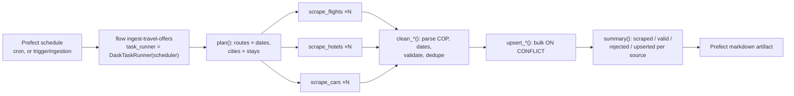

- **Distribution:** every `scrape_*`, `clean_*`, `upsert_*` call is a Prefect task submitted with `.submit()`; `DaskTaskRunner(address="tcp://dask-scheduler:8786")` runs it as a Dask task on one of 3 workers — so the Dask dashboard shows the fan-out and Prefect shows the same tasks with states and retries (FR-02, FR-03, ADR-04).
- **Workers:** 3 × `--nthreads 1` (one Chromium per worker at a time; memory-bounded).
- **Sources (Q-08 a, real sites), chosen by a live spike (`evidence/stage-04/AC-04.0_source-spike.md`):** flights → **Google Flights** (parsed from each row's full-sentence `aria-label`); hotels → **Booking.com** (`data-testid="property-card"`); cars → **Booking.com Cars** (cards anchored on the supplier logo `img[alt^="Supplied by"]`). Kayak cars rendered but has only hashed classes; Rentalcars.com errored. Scraper code adapted from `PA-Taller1/scripts/main.py` (driver setup, anti-detection flags, lazy-load scroll, COP price parsing) — `ingestion/flows/scrapers.py`; parsing/validation in `ingestion/flows/clean.py`.
- **Plan size (default):** 6 routes (BOG↔CTG, BOG↔MDE, BOG↔SMR) × 2 dates (+7, +14 days) for flights; the 4 cities × the same 2 dates × 3-night stays for hotels and cars = 28 scrape tasks, ~2.5 min on 3 workers. Tunable via env (`INGEST_ROUTES`, `INGEST_DAYS_AHEAD`, `INGEST_STAY_NIGHTS`). Searches outside the plan are served by seed offers.
- **Failure injection (demo):** flow parameters `fail_attempts` (every scrape fails its first N attempts → retries) and `break_source` (`google_flights` | `booking` | `booking_cars` always fails → partial success).
- **Schedule:** `flow.serve(cron=INGEST_CRON)`, default every 6 h; manual run = Prefect "Run" button or `triggerIngestion`.
- **Inventory for scraped offers:** sites don't publish seat/room/car counts, so inserted offers get a simulated count (`INGEST_DEFAULT_INVENTORY`, default 5) — documented limitation (ADR-07).

### 6.1 Retry policies (ingestion, FR-04)

| Task | Retries | Delay | Notes |
|---|---|---|---|
| `check_cluster` | 3 | 5 s | fails if fewer than 3 workers have joined |
| `scrape_*` | 3 | exponential backoff 10 / 20 / 40 s, jitter 0.5 | network, timeouts, blocked page, empty grid |
| `clean_*` | 0 | — | pure function; bad rows rejected, not retried |
| `upsert_*` | 2 | 5 s | DB transient errors |

A permanently failing source ends in `Failed` for its tasks; the flow still upserts what other sources returned and finishes with a partial-success summary (AC-04.3).

---

## 7. Security design

### 7.1 Login with session rotation (FR-22, AC-08.2)

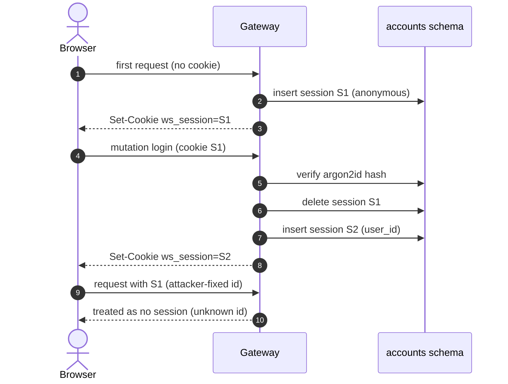

- Token: 32 random bytes (`secrets.token_urlsafe`), only its SHA-256 stored (a DB leak doesn't leak live sessions).
- Unknown/expired cookie values are never adopted (strict mode) — a fresh one is issued instead.
- Cookie: `HttpOnly`, `SameSite=Lax`, `Path=/`, `Secure` off on plain-HTTP localhost (documented). Idle expiry 2 h.
- Logout deletes the row and clears the cookie (AC-08.3).

### 7.2 Passwords (FR-20, FR-21)

Argon2id via `argon2-cffi` `PasswordHasher` — RFC 9106 low-memory profile: `time_cost=3`, `memory_cost=65536` KiB (64 MiB), `parallelism=4`. Policy: 10–128 chars. Registration errors use one generic code (`INVALID_REGISTRATION`) so they don't reveal existing emails. Login error is always `INVALID_CREDENTIALS`, and a dummy hash is verified for unknown emails (similar timing).

### 7.3 Rate limits (FR-23)

In-memory sliding window in the gateway (D-004), applied per GraphQL operation (a proxy only sees `/graphql`, so it can't tell `login` from `cities` — ADR-03).

| Operation | Limit | Key |
|---|---|---|
| `login` | 5 / min | IP |
| `login` | 10 / 15 min | email |
| `register` | 3 / min | IP |
| `bookPackage` (checkout + payment) | 5 / min | user |
| `triggerIngestion` | 2 / min | user |
| any `/graphql` request | 120 / min | IP |

Exceeded → `userErrors[RATE_LIMITED]` in the payload **and** HTTP `429` with `Retry-After` (so it's visible to both clients and tools). Payment has no public endpoint: it only runs inside the saga, behind the rate-limited `bookPackage`.

### 7.4 Other

- CORS: only the frontend origin, with credentials. Mutations only via `POST` + `application/json` (Strawberry default) — with `SameSite=Lax` this blocks cross-site form CSRF.
- Each service connects with its own DB role (least privilege).
- Supply chain (Q-15 a): `pip-audit` on every Python service lockfile, `npm audit` on the frontend lockfile; pinned versions everywhere (NFR-09).

---

## 8. Admin & demo

- Admin account created at gateway startup from `ADMIN_EMAIL` / `ADMIN_PASSWORD` (idempotent).
- Admin-only: `chaos` on `bookPackage`, `triggerIngestion`, and seeing every order.
- Demo dashboards: Prefect `http://localhost:4200`, Dask `http://localhost:8787`, app `http://localhost:3000`, GraphQL `http://localhost:8000/graphql`.

---

## 9. Architecture decision records

| ADR | Decision | Alternatives rejected | Why |
|---|---|---|---|
| ADR-01 | Orchestrated SAGA in a Prefect flow inside `orders-billing-svc` | Choreography (RabbitMQ); separate orchestrator container | Brief requires Prefect for the SAGA; orders owns the order lifecycle; one fewer container (D-005) |
| ADR-02 | Gateway forwards catalog selections to `pg_graphql` (`graphql.resolve`) over SQL | Hand-written SQL per field; Hasura/PostGraphile container | Uses the DB's native GraphQL as the brief asks (§3.3); one round-trip per search with only requested columns = no over-fetching; zero extra containers |
| ADR-03 | Sessions in Postgres, rate limits in gateway memory | Redis; nginx `limit_req` | Minimum containers (D-004); GraphQL operations are only visible inside the app. Ceiling: limits reset on restart, single gateway only |
| ADR-04 | One image for Dask scheduler, workers and ingestion runner; Prefect `DaskTaskRunner` | Separate images; raw `Client` inside tasks (Taller-DASK) | Version parity is mandatory for Dask; tasks show in both Prefect and Dask UIs |
| ADR-05 | Compensate the failed step too, and make cancel tombstone-safe | Compensate only steps that returned success | A timeout means "unknown" — the step may have committed (brief's orphan case). Tombstones make cancel-before-reserve safe. Enables "compensate everything" crash recovery |
| ADR-06 | Compensations retry until success (5 retries, exponential) | Mark order `FAILED` for manual fix | Rubric "Excellent" requires no manual intervention |
| ADR-07 | Inventory = counter per offer, set on insert, never overwritten by ingestion | Unit rows with holds/TTL | Q-25 "simplest that keeps the demo functional"; still proves overbooking prevention (`CHECK >= 0` + conditional update) |
| ADR-08 | One-way outbound flight + hotel + car, 1 traveler | Round trip, N travelers | Halves scraping volume and code for a 1-day deadline; documented limitation |
| ADR-09 | Supabase's `supabase/postgres` image only (not the whole Supabase stack) | Full self-hosted Supabase (~10 containers) | Same `pg_graphql` engine, 1 container (Q-04 c) |

---

## 10. Traceability

| Requirement | Design element |
|---|---|
| FR-01 | §6 sources |
| FR-02, FR-03 | §6 distribution, ADR-04 |
| FR-04 | §6.1 |
| FR-05 | §6 Prefect flow, §1 Prefect server |
| FR-06 | §4.1 natural keys, upsert rule |
| FR-07 | §6 `clean_*`, `summary()` |
| FR-10 | §1 (frontend → gateway only), §5.1 |
| FR-11 | `packageAvailability` §5.1 |
| FR-12 | ADR-02, DataLoader §5.1 |
| FR-13 | `schema.graphql` Mutation |
| FR-20, FR-21 | §7.2 |
| FR-22 | §7.1 |
| FR-23 | §7.3 |
| FR-24 | §7.4 |
| FR-30 | §1.1 containers, §4.1 schemas |
| FR-31 | §5.2 |
| FR-32 | §3, ADR-01 |
| FR-33 | §3.3–3.6 |
| FR-34 | §3.8 |
| FR-35 | §2 |
| FR-36 | §3, §3.10 |
| FR-37 | `ChaosInput` §5.1, §5.2 `chaos` |
| FR-38 | `saga_steps` §4 |
| FR-39 | §5.1 `order` / `myOrders` ownership |
| NFR-01, NFR-02 | §1.1 (healthchecks + `depends_on`) |
| NFR-03 | §4.1 |
| NFR-04 | §2, §3.6, §3.9 |
| NFR-05 | §6 (separate workers, catalog read via views) |
| NFR-06 | §1, §6 |
| NFR-07 | §3.10 step delay |
| NFR-08 | `.env.example`, §4.1 role passwords from env |
| NFR-09 | §7.4 |
| NFR-10 | §1.1, §6 workers `--nthreads 1` |

| Use case | Covered by |
|---|---|
| UC-01, UC-02, UC-03 | §7.1, §7.2 |
| UC-04 | §5.1 `packageAvailability` |
| UC-05 | §3.1 |
| UC-06 | §3.2–3.7, §3.9 |
| UC-07 | §5.1 `order`, `myOrders` |
| UC-08 | §6 |
| UC-09 | §1 dashboards, §8 |
| UC-10 | `ChaosInput` |
| UC-11 | §3.8 |
| UC-12 | §7.3 |
