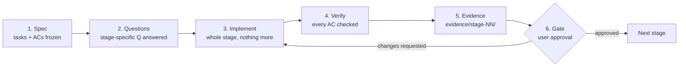
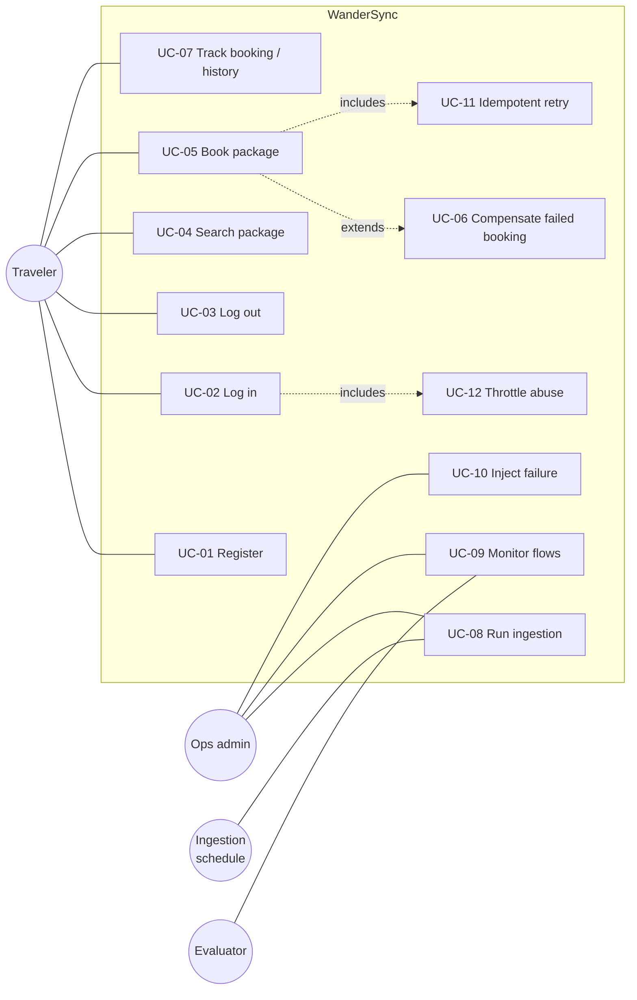
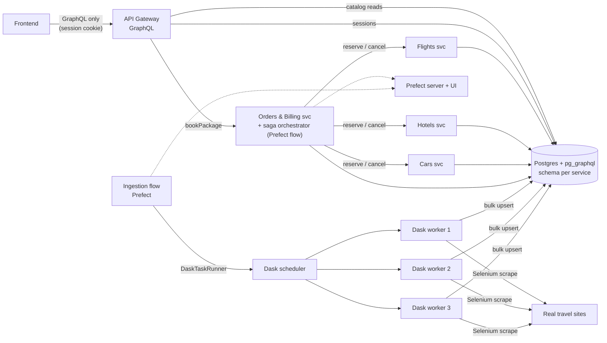
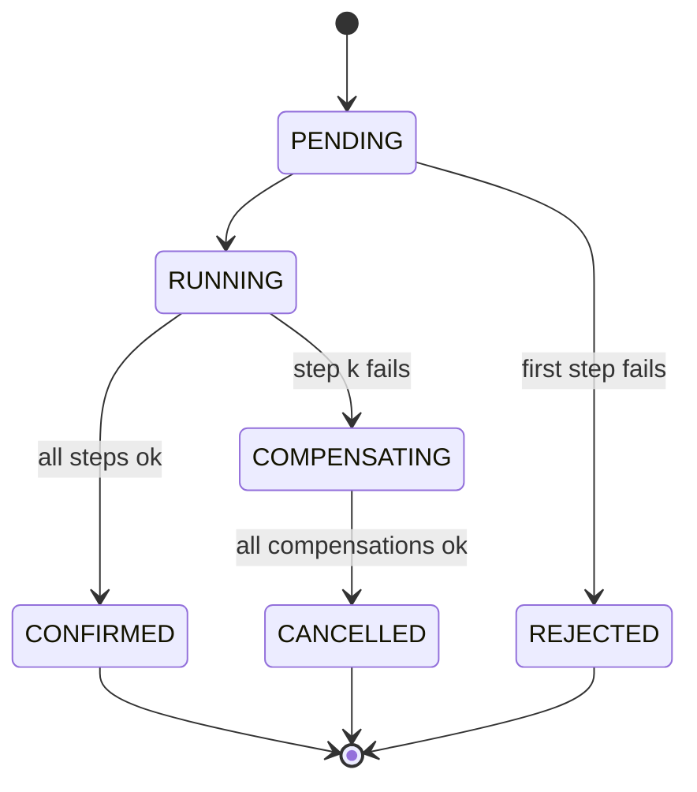

# WanderSync Travel Solutions — Requirements & Spec-Driven Delivery Plan

**Source of truth for grading:** `context/Parcial 2 - Sistema de Reservas Turísticas.md` (copied from `../.context/`). This document turns that brief into a buildable, gated spec. If this document and the brief disagree, the brief wins and this document gets corrected.

**Document status:** Stage 00 closed 2026-10-09 (all §9 questions answered). Gate G1 in progress.

| Field | Value |
|---|---|
| Author | Santiago Prieto (individual) |
| Course | Patrones Arquitectónicos Avanzados — Parcial Práctico, Segundo Corte |
| Duration | 2 weeks (taller extenso) — due **2026-10-10** |
| Repo | `~/Documents/PA/wandersync` (git, `main`) |
| Mandatory tech | Docker Compose · GraphQL · SAGA pattern · Dask · Prefect |

---

## Table of contents

1. [Workflow — how this project is built](#1-workflow--how-this-project-is-built)
2. [Assignment summary](#2-assignment-summary)
3. [User needs](#3-user-needs)
4. [Use cases](#4-use-cases)
5. [Functional & non-functional requirements](#5-functional--non-functional-requirements)
6. [Baseline architecture (draft, pending §9 answers)](#6-baseline-architecture-draft-pending-9-answers)
7. [Reuse inventory — `~/Documents/PA`](#7-reuse-inventory--documentspa)
8. [Stages](#8-stages)
9. [Implementation preference questions](#9-implementation-preference-questions)
10. [Rubric traceability](#10-rubric-traceability)
11. [Decision log & changelog](#11-decision-log--changelog)

---

## 1. Workflow — how this project is built

Spec-driven development: **spec first, code second, evidence always, human gate between stages.**

### 1.1 Stage lifecycle

Every stage goes through the same six steps, in order. A stage is never half-done when the gate is requested.



1. **Spec** — The stage's tasks and acceptance criteria (ACs) in §8 are reviewed. If they need to change, they change *here*, before code, and the change is logged in §11.
2. **Questions** — Every §9 question tagged with this stage must have an answer recorded. Unanswered = recommended default applies, and that is stated explicitly in the gate report.
3. **Implement** — Build everything in the stage's task list. Nothing from a later stage. No "scaffolding for later".
4. **Verify** — Run every AC. Each AC is binary: PASS or FAIL. No "mostly".
5. **Evidence** — Each AC produces at least one artifact in `evidence/stage-NN/` (log capture, test output, screenshot, query result, report). The artifact must be reproducible from a command written in the gate report.
6. **Gate** — Assistant stops, writes `evidence/stage-NN/GATE.md` (template §1.4), and waits. Only an explicit "approved" from the user opens the next stage.

### 1.2 Rules

- **Isolation.** Each stage declares its *inputs* (what previous stages must have delivered) and its *outputs* (what later stages may rely on). A stage may only depend on outputs of already-approved stages.
- **Strict order.** Stages run in the order of §8. Skipping, merging, or reordering requires the user to say so, and is logged in §11.
- **Reopening.** Changing something in an approved stage = formally reopening it: log the reason in §11, re-run *that stage's* ACs, refresh its evidence, re-gate it.
- **One commit (minimum) per stage**, tagged `stage-NN-approved` after the gate passes (see Q-19 for branching model).
- **No secrets in git.** `.env` ignored, `.env.example` committed. Never copy `.env` files from sibling projects (several contain live Supabase keys — see §7).
- **Evidence is real.** Evidence comes from actually running the system, never from describing what it *would* do.

### 1.3 Evidence layout

```
evidence/
  stage-00/
    GATE.md                 # gate report (template below)
    ...                     # raw artifacts: *.txt logs, *.png screenshots, *.json exports, reports
  stage-01/
  ...
```

Naming: `<ac-id>_<short-name>.<ext>`, e.g. `AC-06.3_compensation-car-fails.txt`.

### 1.4 Gate report template (`evidence/stage-NN/GATE.md`)

```markdown
# Stage NN — <name> — Gate report

**Date:** YYYY-MM-DD   **Commit:** <sha>   **Status:** awaiting approval

## Built
- <bullet list of what was delivered, with file paths>

## Acceptance criteria
| AC | Result | Evidence | How to reproduce |
|---|---|---|---|
| AC-NN.1 | PASS | AC-NN.1_xxx.txt | `<command>` |

## Questions answered / defaults applied
- Q-xx: <answer or "default applied: ...">

## Deviations from spec
- <none | what changed and why, also logged in §11>

## Open risks / known limits
- <...>

## Approval
- [ ] Approved by user — date: ____
```

### 1.5 Status tracker

Gates merged to 5 (D-007, deadline 2026-10-10). Each stage still gets its own commit and its own `evidence/stage-NN/`; one `GATE.md` per gate, in `evidence/gate-N/`, covers all its stages.

| Gate | Stage | Name | Status | Gate date |
|---|---|---|---|---|
| G1 | 00 | Decisions & repo bootstrap | done | 2026-10-09 (G1 approved) |
| G1 | 01 | Architecture & design spec | done | 2026-10-09 (G1 approved) |
| G1 | 02 | Infrastructure skeleton (Docker Compose) | done | 2026-10-09 (G1 approved) |
| G1 | 03 | Persistence & GraphQL-native data layer | done | 2026-10-09 (G1 approved) |
| G2 | 04 | Scraping + Dask + Prefect ingestion | done — **G2 awaiting approval** | |
| G3 | 05 | Domain microservices | not started | |
| G3 | 06 | SAGA orchestration (Prefect) | not started | |
| G4 | 07 | GraphQL API Gateway | not started | |
| G4 | 08 | Security by design | not started | |
| G4 | 09 | Frontend | not started | |
| G5 | 10 | End-to-end verification & demo script | not started | |
| G5 | 11 | Technical architecture document & delivery | not started | |

Status values: `not started` · `open` · `in progress` · `awaiting gate` · `approved` · `reopened`.

---

## 2. Assignment summary

### 2.1 Business context

**WanderSync Travel Solutions** is a Travel-Tech startup selling **dynamic travel packages**: flight + hotel + rental car, booked together instantly. To stop depending on closed, expensive commercial APIs, it moves to **automated real-time data extraction** (web scraping) plus a **highly resilient transactional layer** and **massive asynchronous processing**.

### 2.2 Problems to solve

| Problem | Today | Required fix |
|---|---|---|
| **Orphan bookings** ("reservas huérfanas") | Payment charged + flight reserved, but hotel/car confirmation fails on the network → order stuck in an undefined state, no rollback | **SAGA pattern** with automatic **compensating transactions** |
| **Rate-sync bottlenecks** | Massive fare synchronization blocks the persistence layer and network | **Dask** distributed, asynchronous ingestion, orchestrated and observable via **Prefect** |
| **Security** | — | Security by design: session fixation mitigation, Argon2id/bcrypt, rate limiting, supply-chain audit |

### 2.3 Mandatory components

| # | Requirement (brief §) | Summary |
|---|---|---|
| R1 | Scraping (§3.1) | Capture flights, hotel prices, car availability from public sites (Google Flights, Kayak, Booking…) **or mocked services that simulate their complexity**. Source is the student's choice. |
| R2 | Dask ingestion (§3.2) | Scraping, structuring and cleaning run **asynchronously on a Dask worker cluster**, never blocking the main services. |
| R3 | GraphQL-native persistence (§3.3) | Dask output persisted **directly** into a DB with native/transparent GraphQL support (e.g. Supabase + pg_graphql). This DB is the unified source the Gateway consumes. |
| R4 | Microservices + Compose (§4.1) | At least **Flights, Hotels, Cars, Orders/Billing, Gateway** as independent services. Whole system starts with **one `docker compose up`**. |
| R5 | GraphQL Gateway (§4.2) | **All** frontend↔backend traffic goes through one GraphQL gateway. Complex queries to consolidate package availability, mutations to create bookings, **no over-fetching**. |
| R6 | SAGA (§4.3) | Choreography or orchestration. Demonstrate **happy path** and **automatic compensations** on simulated failures (e.g. car fails → cancel flight + hotel consistently). |
| R7 | Dask (§4.4) | Dask coordinates distributed collection, transformation and massive ingestion. |
| R8 | Prefect (§4.5) | A Prefect Flow orchestrates the Dask jobs, with **explicit retry policies**, visible in the Prefect UI. Prefect must be used for **both** ingestion (scraper + DB) **and** SAGA orchestration. |
| R9 | Session security (§5) | Regenerate session ID after successful login (anti session fixation). Passwords hashed with **Argon2id or bcrypt**, high cost factor. |
| R10 | Rate limiting (§5) | On sensitive routes: authentication, payment, booking checkout. |
| R11 | Supply chain (§5) | Formal evidence of dependency audits (`pip-audit`, `npm audit`, …). |

### 2.4 Deliverables (brief §6)

1. **Git repository** — clean, structured: all microservices, frontend, one Dockerfile per service, runnable `docker-compose.yml`.
2. **Technical architecture document** — architecture diagrams, SAGA sequence diagrams (happy path **and** compensation), technical justification of decisions.
3. **Live demo / recording** showing: (a) Prefect dashboard monitoring flows, (b) Dask executing distributed tasks, (c) frontend consuming the GraphQL API, (d) simulated transactional failure with SAGA compensations working.

### 2.5 Rubric

| Criterion | Weight | "Excellent" bar |
|---|---|---|
| Architecture & Dockerization | 15% | Fully automated `docker compose up`; isolated, efficient, correctly configured microservices |
| GraphQL Gateway & persistence | 15% | Fully functional gateway, optimized queries/mutations without over-fetching, smooth DB integration |
| SAGA & transactional consistency | **25%** | Flawless happy path + **automatic** compensations on simulated failures (no manual intervention) |
| Distributed computing & observability (Dask + Prefect) | **25%** | Dask workers doing async scraping/ingestion, integrated with Prefect flows, retries configured, dashboard monitoring |
| Cybersecurity & resilience | 20% | Session fixation mitigation, Argon2id/bcrypt, rate limiting, formal supply-chain audit report |

---

## 3. User needs

### 3.1 Actors

| Actor | Description | Primary interface |
|---|---|---|
| **Traveler** (customer) | Registers, searches, builds and books a package, follows its status | Frontend (via GraphQL gateway) |
| **Operations admin** | Triggers/monitors data ingestion, watches saga runs, injects failures for demos | Frontend admin area + Prefect UI + Dask dashboard |
| **Ingestion system** (non-human) | Scheduled/triggered Prefect flow that scrapes and loads offers through Dask | Prefect deployment |
| **Saga orchestrator** (non-human) | Coordinates the distributed booking transaction and its compensations | Prefect flow |
| **External source** (non-human) | Real or mocked travel sites being scraped | HTTP/HTML |
| **Evaluator** (professor) | Clones the repo, runs one command, watches the demo, reads the doc | Terminal, browser, document |

### 3.2 Needs

| ID | Actor | Need | Why (business value) |
|---|---|---|---|
| UN-01 | Traveler | Search flights, hotels and cars for a destination/date range **in one view** | Core product: dynamic packaging |
| UN-02 | Traveler | See prices and availability that are **recent** (not stale catalog data) | Trust; replaces closed commercial APIs |
| UN-03 | Traveler | Book the whole package **in one action** and get one clear final result: confirmed or cancelled-and-refunded | Eliminates orphan bookings |
| UN-04 | Traveler | **Never be charged** for a package that wasn't fully confirmed | Consistency, legal/financial correctness |
| UN-05 | Traveler | Follow the booking status live and see the history of my bookings | Transparency |
| UN-06 | Traveler | An account that can't be hijacked (secure password storage, secure session) | Security |
| UN-07 | Traveler | Retrying a booking (double click, network retry) must **not** book or charge twice | Idempotency |
| UN-08 | Ops admin | Ingestion runs in the background, never slowing the customer-facing site | Performance (R2) |
| UN-09 | Ops admin | See every ingestion and saga run, its tasks, retries and failures in a dashboard | Observability (R8) |
| UN-10 | Ops admin | Transient scraping/network errors are retried automatically | Resilience |
| UN-11 | Ops admin | Inject failures on purpose (flight/hotel/car/payment step) to prove compensations | Demo + chaos testing |
| UN-12 | Ops admin | Abusive traffic on login/checkout/payment is throttled | Anti brute force / DoS |
| UN-13 | Evaluator | Whole system up with **one command**, no manual steps | Rubric 15% |
| UN-14 | Evaluator | Proof that dependencies were audited for known vulnerabilities | Rubric (R11) |

---

## 4. Use cases

Format: actor · preconditions · main flow · alternative/exception flows · postconditions · traces.

### UC-01 Register account
- **Actor:** Traveler. **Pre:** not logged in.
- **Main:** 1. Submits email + password. 2. Gateway validates format and password policy. 3. Password hashed with Argon2id/bcrypt (high cost). 4. User persisted. 5. Success returned (no session yet, or auto-login → UC-02 step 4 onward).
- **Alt:** A1 email already registered → generic error (no user enumeration). A2 weak password → validation error. A3 too many attempts from same IP → `429` (rate limit).
- **Post:** user row with password hash only (never plaintext). **Traces:** FR-20, FR-21, FR-23.

### UC-02 Log in (session fixation-safe)
- **Actor:** Traveler. **Pre:** account exists. Browser may already carry an anonymous session ID.
- **Main:** 1. Submits credentials. 2. Gateway verifies hash. 3. **Old session ID is invalidated**. 4. **New session ID issued** (`HttpOnly`, `Secure` when TLS, `SameSite`), bound to user. 5. Client proceeds authenticated.
- **Alt:** A1 wrong credentials → generic error, counted toward rate limit. A2 limit exceeded → `429` + retry-after.
- **Post:** pre-login session ID no longer valid (proved in evidence). **Traces:** FR-20, FR-22, FR-23.

### UC-03 Log out
- **Main:** session destroyed server-side, cookie cleared. **Post:** old session ID rejected. **Traces:** FR-22.

### UC-04 Search package availability
- **Actor:** Traveler. **Pre:** offers ingested (UC-08).
- **Main:** 1. Enters origin, destination, dates, travelers. 2. Frontend sends **one GraphQL query** requesting only the fields the screen needs. 3. Gateway resolves flights, hotels, cars in one round-trip (batched, no N+1). 4. Results shown, optionally as pre-combined packages with total price.
- **Alt:** A1 no availability for one component → shown as unavailable, other components still shown. A2 data older than freshness threshold → flagged "stale".
- **Post:** none (read-only). **Traces:** FR-10, FR-11, FR-12.

### UC-05 Book package — happy path
- **Actor:** Traveler. **Pre:** logged in; one flight, one hotel, one car selected.
- **Main:** 1. Frontend calls `bookPackage` mutation with an idempotency key. 2. Gateway (rate-limited) creates order `PENDING` and starts the saga flow. 3. Saga runs every forward step (order of steps: Q-07). 4. All succeed → order `CONFIRMED`. 5. Frontend shows confirmation with all references.
- **Post:** flight seat, hotel room, car unit reserved; payment captured; order `CONFIRMED`; full step trail stored. **Traces:** FR-30–FR-35.

### UC-06 Book package — failure with automatic compensation
- **Actor:** Traveler (+ Ops admin injecting the failure). **Pre:** same as UC-05; a failure is injected or occurs naturally at step *k*.
- **Main:** 1–3 as UC-05. 4. Step *k* fails (rejection, timeout, or service down). 5. Saga runs compensations for steps *k-1 … 1* in **strict reverse order** (e.g. car fails → cancel hotel → cancel flight → refund payment). 6. Each compensation is idempotent and retried until success. 7. Order ends `CANCELLED` (terminal), reason recorded.
- **Alt:** A1 failure at the very first step → nothing to compensate, order `REJECTED`. A2 a compensation call itself fails transiently → Prefect retry policy re-runs it; order stays `COMPENSATING` until done (never left undefined).
- **Post:** no reservation remains for this order in any service, no money retained; inventory restored. **Traces:** FR-33–FR-37.

### UC-07 Track booking & history
- **Actor:** Traveler. **Main:** sees live step-by-step status of the current booking (pending/running/ok/failed/compensating/compensated) and a list of own past bookings with drill-down to their step trail. Users only see their own orders. **Traces:** FR-38, FR-39.

### UC-08 Run data ingestion
- **Actor:** Ingestion system (schedule) or Ops admin (manual trigger). **Pre:** Dask cluster and Prefect server up.
- **Main:** 1. Prefect flow starts. 2. Builds the scrape plan (sources × routes/cities × dates). 3. Fans out scrape tasks on Dask workers in parallel. 4. Each partition is parsed, cleaned, normalized, deduplicated. 5. Valid rows upserted into the DB (bulk). 6. Quality gate + run summary (rows in/out/rejected) logged.
- **Alt:** A1 transient source/network error → task retried per retry policy. A2 source permanently down → task fails after retries, flow completes partially, failure visible in Prefect UI. A3 malformed records → quarantined/rejected and counted, not loaded.
- **Post:** offers refreshed with `scraped_at` timestamp; customer-facing services unaffected during the run. **Traces:** FR-01–FR-07.

### UC-09 Monitor flows and distributed execution
- **Actor:** Ops admin / Evaluator. **Main:** opens Prefect UI → sees ingestion and saga flow runs, task states, retries, logs. Opens Dask dashboard → sees task stream across multiple workers during ingestion. **Traces:** FR-05, FR-36, NFR-06.

### UC-10 Inject failure (chaos)
- **Actor:** Ops admin. **Main:** selects which step will fail (flight/hotel/car/payment) and how (reject/timeout/crash) — mechanism per Q-17 — then runs UC-05/UC-06. **Traces:** FR-37.

### UC-11 Idempotent retry
- **Actor:** Traveler/client. **Main:** same `bookPackage` request resent with same idempotency key → original result returned, no second saga run, no double charge. **Traces:** FR-34.

### UC-12 Throttled abuse
- **Actor:** Attacker / misbehaving client. **Main:** exceeds N requests/window on login, register, `bookPackage`, payment → `429` with `Retry-After`; legitimate traffic on other routes unaffected. **Traces:** FR-23.

### 4.1 Use case diagram



---

## 5. Functional & non-functional requirements

### 5.1 Functional requirements

**Ingestion (Dask + Prefect + scraping)**

| ID | Requirement |
|---|---|
| FR-01 | System scrapes flight itineraries/prices, hotel room prices/availability, and car rental availability from the sources chosen in Q-08. |
| FR-02 | Scraping, parsing, cleaning and normalization run as tasks on a **Dask cluster with ≥ 2 workers** (Q-26), in parallel. |
| FR-03 | The ingestion pipeline is a **Prefect flow** whose tasks execute on Dask (e.g. `prefect-dask` `DaskTaskRunner`). |
| FR-04 | Network/extraction tasks declare **explicit retries** (`retries`, `retry_delay_seconds`, optional backoff/jitter). |
| FR-05 | Every ingestion run is visible in the Prefect UI with per-task state and retry history. |
| FR-06 | Cleaned records are **upserted directly** into the GraphQL-native DB in bulk, deduplicated by a natural key; each record carries `source` and `scraped_at`. |
| FR-07 | Invalid records are rejected and counted; a run summary (scraped / valid / rejected / upserted) is produced. |

**Query side (GraphQL gateway)**

| ID | Requirement |
|---|---|
| FR-10 | The frontend talks to the backend **only** through one GraphQL endpoint. |
| FR-11 | A query consolidates package availability (flights + hotels + cars, filtered by route/dates/travelers) in a single request. |
| FR-12 | Resolvers fetch only requested fields and batch lookups (no N+1, no over-fetching). |
| FR-13 | Mutations exist for: register, login, logout, `bookPackage`, (admin) trigger ingestion, (admin) chaos config. |

**Booking (SAGA)**

| ID | Requirement |
|---|---|
| FR-30 | Flights, Hotels, Cars, Orders/Billing are separate services, each owning its data (no cross-service DB access). |
| FR-31 | Each domain service exposes a **reserve** and a **cancel (compensate)** operation; Orders/Billing exposes **charge** and **refund**. |
| FR-32 | `bookPackage` runs as a **SAGA** (style per Q-06) coordinated with **Prefect**. |
| FR-33 | On failure at any step, completed steps are compensated in **strict reverse order**, automatically. |
| FR-34 | Every mutating operation (forward and compensation) is **idempotent**, keyed by order/saga ID. |
| FR-35 | Order states follow one state machine: `PENDING → RUNNING → CONFIRMED`, or `→ COMPENSATING → CANCELLED`, or `→ REJECTED` (first-step failure). No other terminal states. |
| FR-36 | Every saga run is a Prefect flow run; each step and compensation is a visible task; compensation tasks have retry policies. |
| FR-37 | Failure injection per step (flight, hotel, car, payment) and per mode (reject, timeout, crash). |
| FR-38 | Each order stores its step trail (step, status, timestamps, error). |
| FR-39 | Users see live status and history of **their own** orders only. |

**Security**

| ID | Requirement |
|---|---|
| FR-20 | Passwords stored only as Argon2id or bcrypt hashes with a documented high cost factor. |
| FR-21 | Registration enforces a password policy; errors don't reveal whether an email exists. |
| FR-22 | Session ID is **regenerated on login** and destroyed on logout; old IDs are rejected. Cookies `HttpOnly`, `SameSite`, `Secure` where TLS applies. |
| FR-23 | Rate limiting on login, register, `bookPackage`/checkout and payment; returns `429` + `Retry-After`. |
| FR-24 | Dependency audit for every language ecosystem used (+ container images per Q-15); report committed as evidence; criticals/highs fixed or justified. |

### 5.2 Non-functional requirements

| ID | Requirement |
|---|---|
| NFR-01 | `docker compose up` from a clean clone (plus `cp .env.example .env`) brings the full system up with no manual steps. **Whole stack is local Docker — no cloud services** (no hosted DB, no hosted auth, no external payment provider). Only scraped *data sources* may be external (Q-08). |
| NFR-02 | Every service has a Dockerfile and a healthcheck; dependencies start via `depends_on: condition: service_healthy`. |
| NFR-03 | Database-per-service (separate DB or separate schema with separate credentials — Q-05). |
| NFR-04 | Eventual consistency: after any failure path, all services reconcile to a correct terminal state; no orphan reservations, no retained charge. Verified by a reconciliation query/script. |
| NFR-05 | Ingestion never blocks customer-facing services (search/booking latency stays normal during a run). |
| NFR-06 | Observability: Prefect UI (flows), Dask dashboard (workers/task stream), structured service logs with saga/order ID correlation. |
| NFR-07 | Configurable per-step artificial delay in sagas so transitions are visible in the demo (reuse `shared/delay.py`). |
| NFR-08 | No secrets in git; all config via env vars; `.env.example` documented. |
| NFR-09 | Pinned dependency versions + lockfiles committed (needed for reproducible audits). |
| NFR-10 | Runs on the user's machine within the resource budget (Q-26). |

---

## 6. Baseline architecture (draft, pending §9 answers)

Shown with the **recommended defaults** from §9. Stage 01 freezes the final version.



### 6.1 Saga (default: orchestration, payment early — Q-06, Q-07)

Forward: `create order (PENDING)` → `charge payment` → `reserve flight` → `reserve hotel` → `reserve car` → `confirm order`.
Compensation (reverse of completed steps): `cancel car` → `cancel hotel` → `cancel flight` → `refund payment` → `order CANCELLED`.

Payment early reproduces the brief's exact "orphan booking" scenario (paid + flight reserved, hotel/car fails) so the compensation demo includes a refund. The alternative (payment last, as the pivot step) is cheaper in real life — that trade-off is Q-07.



### 6.2 Container inventory (default)

| Container | Role | Host port |
|---|---|---|
| `frontend` | UI | 3000 |
| `gateway` | GraphQL API gateway, auth, sessions (Postgres), rate limit (memory) | 8000 |
| `flights-svc`, `hotels-svc`, `cars-svc` | Domain services: offers + reservations | internal |
| `orders-billing-svc` | Orders, payments (mock), refunds **+ saga orchestrator Prefect flow** (D-005) | internal |
| `ingestion` | Prefect ingestion flow served on a schedule (`flow.serve(cron=...)`) | internal |
| `dask-scheduler` | Dask scheduler + dashboard | 8787 |
| `dask-worker` ×3 | Dask workers (scraper deps baked in) | internal |
| `prefect-server` | Prefect API + UI | 4200 |
| `postgres` | `supabase/postgres` with `pg_graphql`, one schema per service, sessions table | internal |

Not needed (decided): `redis` (D-004), separate `saga-orchestrator` (D-005), `mock-sources` (Q-08 = real sites).

---

## 7. Reuse inventory — `~/Documents/PA`

Rule: **copy and adapt, never import across repos.** Never copy `.env` files (real Supabase keys exist in `PA-Taller1/api/.env`, `PA-Taller1/scripts/.env`, `Taller-GraphQL/backend/.env`, `Taller-PatronSaga/.env`, `primer-parcial/frontend/.env.local`).

### 7.1 Primary sources

#### `PA-Taller1/` — Web scraper (exito.com) → **Stage 04**
| Asset | What it is | Reuse for |
|---|---|---|
| `scripts/main.py` | `ExitoScraper` class: headless Selenium Chrome, anti-bot flags (`AutomationControlled`, `navigator.webdriver` patch, UA), cookie banner dismissal, lazy-load scroll, CSS selector fallbacks, `_texto_opcional`/`_atributo_opcional` safe extractors, regex price parser, dataclass records, context manager | Base for the scraper module running inside Dask workers. Generalize: one parser per source (flights/hotels/cars), keep driver setup + safe extractors + price parser |
| `scripts/Dockerfile` | `python:3.12-slim` + Debian `chromium` + `chromium-driver` (version-matched, avoids Selenium Manager download failures) | Base for the **Dask worker image** if Selenium is chosen (Q-09) |
| `scripts/server.py` | FastAPI trigger endpoint `POST /scrape` | Pattern for an admin "trigger ingestion" path (replaced by a Prefect deployment run) |
| `api/supabase_client.py`, `api/main.py`, `api/schema.sql` | Supabase client from env, bulk insert, table + RLS (public read, `service_role` write) | Persistence pattern if Supabase is chosen (Q-04); RLS template |
| `.gitignore` | Generic | ⚠ Ignores `package-lock.json` / `yarn.lock` — **do not reuse as is**: lockfiles are required for `npm audit` (FR-24, NFR-09) |

#### `Taller-PatronSaga/` — NovaBank saga (orchestrated + choreographed) → **Stages 02, 05, 06, 09**
| Asset | What it is | Reuse for |
|---|---|---|
| `services/saga-orchestrator/app/flow.py` | Prefect 3 async flow; one `@task` per step and per compensation; domain exceptions (`InsufficientFunds`, `RiskRejected`, `InterbankTimeout`) mapped from HTTP status; reverse-order compensation; `cache_policy=NONE` | **Direct template** for the booking saga (Stage 06): steps → charge/flight/hotel/car, compensations → refund/cancel×3. Add `retries` on compensation tasks |
| `services/*/app/core.py`, `db.py`, `main.py` | FastAPI services with isolated DBs; `core.py` shared by REST + consumer so both saga modes can't drift; idempotency records keyed by `transfer_id` written atomically with the side effect | Template for Flights/Hotels/Cars/Orders services (Stage 05): reserve/cancel endpoints + idempotency table |
| `shared/delay.py` | Configurable 2–4 s step delay from env | NFR-07 as is |
| `shared/events.py`, `shared/rabbitmq.py` | Event catalog + aio-pika topic-exchange pub/sub helper | Only if choreography (Q-06) or event-based status streaming to the gateway |
| `scripts/simulate.py` | Stdlib-only CLI running every test case against the live API, diffing state trails | Template for `scripts/simulate_saga.py` (Stage 06/10 evidence generator) |
| `docker-compose.yml` | Healthcheck YAML anchor for FastAPI, `service_healthy` chains, Postgres/Mongo/RabbitMQ/Prefect configs, `PREFECT_UI_API_URL` fix ("Unable to connect to Prefect server") | Stage 02 compose skeleton |
| `services/api-gateway/app/store.py` | In-memory status cache aggregating saga events | Idea for live order status; replace with DB/Redis-backed |
| `frontend/` | Next.js + TS + Tailwind v4 + shadcn/ui; tracker, receipt, history/detail, state badges, **dev drawer with chaos switches**, auth-gate (stub — no real auth) | Stage 09 if Next.js chosen (Q-11): tracker/history/chaos drawer components. Auth must be rebuilt for real (R9) |
| `requirements.md` | Staged requirements + FR/NFR evidence format | Already reflected in this document's style |

### 7.2 Secondary sources

#### `Taller-DASK/` — Dask cluster + Prefect cleaning pipeline → **Stages 02, 04**
| Asset | What it is | Reuse for |
|---|---|---|
| `docker-compose.yml` | 1 scheduler (8786/8787) + 3 named workers with CPU/memory limits + Prefect server + runner | Stage 02 Dask section |
| `flows/clean_pipeline.py` | Prefect flow: `validate_infrastructure` (retries=3), per-worker ingest/clean tasks pinned with `workers=[...]`, `quality_gate` with anomaly threshold, `chunk_evenly` | Stage 04 flow shape, quality gate, cleaning helpers (`fix_mojibake`, normalizers) |
| `start.sh` | `up/run/down/clean/uninstall`; `wait_for_workers` polls scheduler for N workers | Demo/ops helper; worker-readiness check as a healthcheck |
| `generate_dirty_data.py` | Synthetic dirty dataset generator | Pattern for generating messy mock-source data (Q-08) |
| ⚠ Versions | Pins **Prefect 2.20.4** (Saga project uses Prefect 3) and creates a raw `dask.distributed.Client` inside each task | Unify on **Prefect 3** + `prefect-dask` `DaskTaskRunner` (native integration: Prefect task runs become Dask tasks, visible in both UIs) |

#### `Taller-GraphQL/` — Afirmative Pill (Apollo + CQRS) → **Stage 07 (+09)**
| Asset | What it is | Reuse for |
|---|---|---|
| `backend/schema.graphql` | Documented SDL: custom scalars (`DateTime`, `COP`, `PositiveInt`), enums, `UserErrorCode` typed errors | Contract style for the gateway SDL |
| `backend/src/loaders.js` | Per-request DataLoaders, `WHERE id = ANY($1)` batching | **Anti-N+1 / over-fetching** evidence (rubric) — same pattern in Python via `aiodataloader`/Strawberry DataLoader if Python gateway |
| `backend/src/commands.js`, `projector.js` | CQRS write side, transactional outbox, `FOR UPDATE SKIP LOCKED` projector, subscriptions via `graphql-ws` | Optional: live order status via GraphQL subscription; outbox if events are needed |
| `backend/src/index.js` | Express + Apollo Server 5, single `/graphql` route, everything else 404 | "Zero-REST" gateway if Node is chosen (Q-03) |
| `frontend/` | React 19 + Vite + Apollo Client 4, catalog/cart/order pages | Stage 09 if Vite/React chosen (Q-11) |
| `backend/test/commands.test.js` | `node --test` tests | Test style for a Node gateway |

#### `primer-parcial/` — Emergency coordination (AWS SAM + Supabase + Next.js) → **process, Stages 03, 08, 09, 11**
| Asset | What it is | Reuse for |
|---|---|---|
| `docs/requirements.md` §11 | Approval-gated staged delivery with per-stage verification notes | Process model already adopted here |
| `tests/README.md`, `tests/canary-test-*.txt` | Evidence-capture convention: real runs, reproduce commands, cleanup proof | `evidence/` convention (§1.3) |
| `supabase/migrations/0001–0049` | Numbered SQL migrations, enums, RLS policies, `search_path` hardening (`0010`) | Stage 03 migrations + RLS + function hardening patterns |
| `frontend/` | Next.js 16 + Supabase JS + Leaflet | Optional map of destinations; Supabase auth is **not** used here (sessions must be server-side, R9) |
| `docs/architecture-report.html` | Previous architecture report | Template/structure for Stage 11 document |
| `infra/template.yaml`, `scripts/test-canary.sh` | AWS SAM, Lambda alias canary | Not applicable (no AWS in this project) |

#### `PA-Taller-Clase4/` — Strangler fig / canary Lambdas
| Asset | Reuse for |
|---|---|
| `legacy-monolith.js`, `modern-orders.js`, `traffic-test.js` | Not reusable as code (AWS Lambda handlers). Concept only: `?simulate_failure=true` failure injection flag → same idea as FR-37 |

#### `Taller 1/`
| Asset | Reuse for |
|---|---|
| `.env/` (a Python 3.14 virtualenv: selenium deps, websocket-client, numpy) | Nothing — no source code. Ignore |

### 7.3 Reuse map by stage

| Stage | Pull from |
|---|---|
| 02 Infra | `Taller-PatronSaga/docker-compose.yml` (healthchecks, Prefect), `Taller-DASK/docker-compose.yml` (Dask cluster) |
| 03 Persistence | `primer-parcial/supabase/migrations`, `PA-Taller1/api/schema.sql` |
| 04 Ingestion | `PA-Taller1/scripts/main.py` + Dockerfile, `Taller-DASK/flows/clean_pipeline.py`, `generate_dirty_data.py` |
| 05 Services | `Taller-PatronSaga/services/*` (core/db/main split, idempotency) |
| 06 Saga | `Taller-PatronSaga/services/saga-orchestrator/app/flow.py`, `shared/delay.py`, `scripts/simulate.py` |
| 07 Gateway | `Taller-GraphQL/backend` (SDL, DataLoaders, single-route) |
| 09 Frontend | `Taller-PatronSaga/frontend` or `Taller-GraphQL/frontend` (Q-11) |
| 11 Document | `primer-parcial/docs/architecture-report.html`, Saga README diagrams |

---

## 8. Stages

Each stage: **Goal · Inputs · Tasks · Out of scope · Acceptance criteria · Evidence · Questions to answer first.**

### Stage 00 — Decisions & repo bootstrap

- **Goal:** lock every implementation preference; create the empty, clean repo structure.
- **Inputs:** this document.
- **Tasks:**
  - T00.1 User answers §9 (or accepts defaults); answers copied into §11 Decision log.
  - T00.2 Update §6 architecture and §8 tasks to match the answers.
  - T00.3 Repo skeleton: `README.md` (stub), `.gitignore` (keeps lockfiles), `.env.example`, `evidence/`, `docs/`, `context/`.
  - T00.4 Git conventions per Q-19 (branch model, commit style, remote if any).
- **Out of scope:** any service code, compose file.
- **Acceptance criteria:**
  - AC-00.1 Every Q in §9 has an answer or an explicit "default accepted".
  - AC-00.2 §11 Decision log lists every decision with date.
  - AC-00.3 `git status` clean after first commit; `.env` ignored, `.env.example` tracked; lockfiles **not** ignored.
- **Evidence:** `AC-00.3_git-status.txt`, `AC-00.3_check-ignore.txt` (`git check-ignore -v .env package-lock.json`).
- **Questions:** all of §9.

### Stage 01 — Architecture & design spec

- **Goal:** design everything before code: contracts that later stages implement.
- **Inputs:** Stage 00.
- **Tasks:**
  - T01.1 Component/deployment diagram (all containers, networks, ports, sync vs async arrows).
  - T01.2 SAGA sequence diagrams: happy path + one per failure point (payment, flight, hotel, car) showing compensations in reverse order + idempotent retry.
  - T01.3 Order state machine (final version of §6.1).
  - T01.4 Data model per service (ER per schema): offers, reservations, idempotency records, orders, payments, saga steps, users, sessions.
  - T01.5 GraphQL SDL contract (`docs/schema.graphql`): queries, mutations, types, error model.
  - T01.6 Internal service API contracts (OpenAPI or table): reserve/cancel/charge/refund, status codes that map to saga exceptions.
  - T01.7 Ingestion design: source list, scrape plan, record schemas, natural keys for dedupe, retry policy table, Dask partitioning.
  - T01.8 Security design: session flow (fixation-safe), hashing parameters, rate-limit table (route → limit → window → key).
  - T01.9 ADRs (one short file per major decision) in `docs/adr/`.
- **Out of scope:** runnable code.
- **Acceptance criteria:**
  - AC-01.1 All diagrams render (Mermaid) and cover every UC in §4.
  - AC-01.2 SDL parses with a GraphQL validator, covers FR-10–FR-13.
  - AC-01.3 Every failure point has a sequence diagram with explicit reverse-order compensations (FR-33).
  - AC-01.4 Every FR/NFR in §5 maps to at least one design element (traceability table in `docs/design.md`).
- **Evidence:** `AC-01.2_sdl-validate.txt`, rendered diagrams (PNG/SVG or artifact link), traceability table.
- **Questions:** Q-06, Q-07, Q-21, Q-25.

### Stage 02 — Infrastructure skeleton (Docker Compose)

- **Goal:** every container from §6.2 starts with one command and becomes healthy; services are "hello world" with `/health`.
- **Inputs:** Stage 01 (container inventory, ports, networks).
- **Tasks:**
  - T02.1 `docker-compose.yml`: networks, volumes, env via `.env`, healthchecks, `service_healthy` dependency chains.
  - T02.2 One Dockerfile per service (minimal, non-root user, pinned base image).
  - T02.3 Dask scheduler + N workers (worker image includes scraper deps per Q-09), resource limits.
  - T02.4 Prefect server reachable from browser (`PREFECT_UI_API_URL`), Postgres-backed if desired.
  - T02.5 Postgres + Redis + mock-sources placeholder.
  - T02.6 `Makefile` or `start.sh` helpers (optional, Q-18).
- **Out of scope:** business logic.
- **Acceptance criteria:**
  - AC-02.1 From a clean clone: `cp .env.example .env && docker compose up -d` → all containers `healthy` with no manual step.
  - AC-02.2 Dask dashboard shows N workers connected.
  - AC-02.3 Prefect UI loads and its API answers `/api/health`.
  - AC-02.4 Only the ports in §6.2 are published on the host.
  - AC-02.5 `docker compose down -v && up -d` is repeatable (no state-dependent startup).
- **Evidence:** `AC-02.1_compose-ps.txt`, `AC-02.2_dask-workers.png|txt`, `AC-02.3_prefect-health.txt`, `AC-02.4_ports.txt`.
- **Questions:** Q-02, Q-04, Q-05, Q-26.

### Stage 03 — Persistence & GraphQL-native data layer

- **Goal:** schemas, migrations, seed data; DB exposes GraphQL natively (R3).
- **Inputs:** Stage 01 data model, Stage 02 DB container.
- **Tasks:**
  - T03.1 Migrations per service schema (offers, reservations, idempotency, orders, payments, saga steps, users).
  - T03.2 Enable GraphQL on the DB (`pg_graphql` / Supabase / alternative per Q-04); expose read-only catalog views.
  - T03.3 Per-service DB roles: each service can only touch its schema (NFR-03).
  - T03.4 Natural-key unique constraints for ingestion upserts; inventory constraints (`available >= 0`) as DB `CHECK`.
  - T03.5 Seed script (minimal offers so later stages work before ingestion runs).
- **Out of scope:** ingestion, services.
- **Acceptance criteria:**
  - AC-03.1 Migrations apply on an empty DB automatically at startup.
  - AC-03.2 A GraphQL query against the DB's native GraphQL endpoint returns seeded offers.
  - AC-03.3 Service role X cannot read/write schema Y (permission error captured).
  - AC-03.4 Inventory can't go negative (constraint violation captured).
- **Evidence:** `AC-03.1_migrate.txt`, `AC-03.2_pg-graphql-query.json`, `AC-03.3_role-isolation.txt`, `AC-03.4_check.txt`.
- **Questions:** Q-04, Q-05, Q-22.

### Stage 04 — Scraping + Dask + Prefect ingestion

- **Goal:** R1, R2, R3, R7, R8 (ingestion half).
- **Inputs:** Stage 02 (Dask, Prefect), Stage 03 (tables, upsert keys).
- **Tasks:**
  - T04.1 Sources: build mock travel sites and/or adapters to real sites (Q-08) — realistic complexity: pagination, JS-rendered content, inconsistent formats, random latency/5xx to exercise retries.
  - T04.2 Scraper module per source, adapted from `PA-Taller1/scripts/main.py` (Q-09).
  - T04.3 Cleaning/normalization (currency, dates, city codes, dedupe), adapted from `Taller-DASK` helpers.
  - T04.4 Prefect 3 flow with `DaskTaskRunner(address=scheduler)`: plan → fan-out scrape → clean → bulk upsert → quality gate → summary artifact.
  - T04.5 Explicit retry policies per task type (scrape: retries + exponential backoff + jitter; upsert: retries; infra check: retries).
  - T04.6 Deployment + schedule and/or manual trigger (Q-10).
  - T04.7 Failure-injection knob on sources to prove retries live.
- **Out of scope:** booking, gateway.
- **Acceptance criteria:**
  - AC-04.1 A flow run scrapes flights, hotels and cars and upserts them; row counts per source recorded.
  - AC-04.2 Dask dashboard task stream shows tasks distributed over ≥ 2 workers during the run.
  - AC-04.3 With source failure injection on, Prefect UI shows tasks `Retrying` then `Completed`; with permanent failure, task `Failed` after N retries and the flow reports partial success.
  - AC-04.4 Re-running the flow does not create duplicates (upsert by natural key).
  - AC-04.5 Malformed records rejected and counted in the summary.
  - AC-04.6 During an ingestion run, a catalog read latency stays within baseline (NFR-05).
  - AC-04.7 Scheduled run (if Q-10 includes schedule) fires without manual action.
- **Evidence:** `AC-04.1_run-summary.json`, `AC-04.2_dask-task-stream.png`, `AC-04.3_prefect-retries.png` + flow-run log export, `AC-04.4_dedupe.txt`, `AC-04.6_latency.txt`.
- **Questions:** Q-08, Q-09, Q-10, Q-26.

### Stage 05 — Domain microservices

- **Goal:** Flights, Hotels, Cars, Orders/Billing with reserve/cancel/charge/refund, idempotent, failure-injectable.
- **Inputs:** Stage 03 schemas, Stage 01 internal API contracts.
- **Tasks:**
  - T05.1 Flights/Hotels/Cars: `reserve` (atomic inventory decrement), `cancel` (restore), `get`; idempotency by saga ID.
  - T05.2 Orders/Billing: create order, update state, `charge`, `refund` (mock payment per Q-16), step trail.
  - T05.3 Failure injection per Q-17 (reject → 4xx domain error, timeout → sleep past client timeout, crash → 5xx).
  - T05.4 Unit tests per service (pytest or equivalent): happy, idempotent replay, cancel-after-cancel, cancel-without-reserve (no-op), concurrent reserve on last unit.
- **Out of scope:** saga coordination, gateway.
- **Acceptance criteria:**
  - AC-05.1 Each operation works in isolation (tests pass).
  - AC-05.2 Same request replayed returns same result, no double side effect.
  - AC-05.3 Compensation is idempotent and safe if the forward step never happened.
  - AC-05.4 Two concurrent reserves on the last unit → exactly one succeeds.
  - AC-05.5 Each failure-injection mode produces its documented status code.
- **Evidence:** `AC-05.x_pytest-<svc>.txt`, `AC-05.4_concurrency.txt`.
- **Questions:** Q-16, Q-17, Q-25.

### Stage 06 — SAGA orchestration (Prefect)

- **Goal:** R6, R8 (saga half) — the 25% criterion.
- **Inputs:** Stage 05 services.
- **Tasks:**
  - T06.1 Prefect flow `book-package-saga` adapted from `Taller-PatronSaga` `flow.py`: one task per step and per compensation.
  - T06.2 Retry policy on forward tasks (only for transient errors) and on compensation tasks (must eventually succeed).
  - T06.3 Order state transitions + step trail written at every step.
  - T06.4 Step delay (NFR-07).
  - T06.5 `scripts/simulate_saga.py`: runs every case, prints final states and reconciliation result.
  - T06.6 Reconciliation check: no reservations/charges left for non-`CONFIRMED` orders (NFR-04).
  - T06.7 Recovery: if orchestrator crashes mid-saga, the order is resumed or compensated on restart (Q-24).
- **Out of scope:** gateway/frontend.
- **Acceptance criteria (test cases):**

| AC | Case | Expected |
|---|---|---|
| AC-06.1 | Happy path | `CONFIRMED`; 1 charge, 3 reservations |
| AC-06.2 | Payment fails (1st forward step after order) | `REJECTED`; nothing to compensate |
| AC-06.3 | Flight fails | refund → `CANCELLED` |
| AC-06.4 | Hotel fails | cancel flight → refund → `CANCELLED` |
| AC-06.5 | Car fails (brief's example) | cancel hotel → cancel flight → refund → `CANCELLED` |
| AC-06.6 | Timeout (not rejection) at hotel | treated as failure; compensations run; late success at hotel can't leave an orphan (cancel is idempotent and wins) |
| AC-06.7 | Compensation transiently fails | Prefect retries; order ends `CANCELLED` without manual action |
| AC-06.8 | Same idempotency key twice | second call returns first result; no second flow run |
| AC-06.9 | Reconciliation after all cases | zero orphan reservations, zero retained charges |

- **Evidence:** `AC-06.x_<case>.txt` from `simulate_saga.py`, Prefect UI screenshots per case showing failed + compensation tasks, `AC-06.9_reconciliation.txt`.
- **Questions:** Q-06, Q-07, Q-17, Q-24.

### Stage 07 — GraphQL API Gateway

- **Goal:** R5 — single entry point, consolidated queries, booking mutation, no over-fetching.
- **Inputs:** Stage 03 (catalog in DB), Stage 06 (saga trigger), Stage 01 SDL.
- **Tasks:**
  - T07.1 Gateway implementing `docs/schema.graphql` (Q-03).
  - T07.2 `packageAvailability` query consolidating flights/hotels/cars, filters, pagination.
  - T07.3 DataLoaders / batched resolvers; field-level resolution so unrequested fields are never fetched.
  - T07.4 `bookPackage` mutation → starts saga, returns order ID immediately; `order(id)` query + live status (polling or subscription, Q-11).
  - T07.5 Typed error model (`UserError` codes), query depth/complexity limit, introspection off in "prod" mode (Q-15).
  - T07.6 Only `/graphql` exposed (plus `/health`).
- **Out of scope:** auth hardening (Stage 08) — but resolvers already receive a `user` context stub.
- **Acceptance criteria:**
  - AC-07.1 One request returns a full package search result for a route/date.
  - AC-07.2 Query log shows a constant number of DB/service calls regardless of result size (no N+1).
  - AC-07.3 Requesting fewer fields reduces selected columns/payload (no over-fetching) — captured SQL/log comparison.
  - AC-07.4 `bookPackage` triggers a saga visible in Prefect; `order` query reflects its state transitions.
  - AC-07.5 Any non-`/graphql` path returns 404; depth-limit rejects an abusive nested query.
- **Evidence:** `AC-07.1_query.json`, `AC-07.2_n+1-log.txt`, `AC-07.3_fields-vs-sql.txt`, `AC-07.4_mutation-to-prefect.png`.
- **Questions:** Q-03, Q-11.

### Stage 08 — Security by design

- **Goal:** R9, R10, R11 — the 20% criterion.
- **Inputs:** Stage 07 gateway.
- **Tasks:**
  - T08.1 Register/login/logout mutations; Argon2id (or bcrypt) with documented parameters (Q-13); password policy.
  - T08.2 Server-side sessions (Q-12) with **ID regeneration on login**, destroy on logout, cookie flags.
  - T08.3 Authorization: `bookPackage`, `myOrders`, `order` require session; users see only own orders; admin-only mutations.
  - T08.4 Rate limiting (Q-14) on login, register, `bookPackage`, payment path — per IP and per account where relevant.
  - T08.5 Supply-chain audit: `pip-audit` per Python service, `npm audit` for Node packages, plus Q-15 extras (image scan, SBOM). Fix or document every high/critical.
  - T08.6 Security headers / CORS restricted to the frontend origin.
- **Out of scope:** TLS termination (local demo) unless Q-15 says otherwise.
- **Acceptance criteria:**
  - AC-08.1 DB shows only Argon2id/bcrypt hashes with the configured cost; plaintext never logged.
  - AC-08.2 **Session fixation test:** session ID captured before login ≠ after login; old ID rejected after login (scripted).
  - AC-08.3 Logout invalidates the session server-side.
  - AC-08.4 N+1-th login attempt within the window → `429` + `Retry-After`; same for `bookPackage` and payment.
  - AC-08.5 User A can't read user B's order.
  - AC-08.6 Audit reports committed; zero unresolved critical/high (or each justified).
- **Evidence:** `AC-08.1_hash-sample.txt`, `AC-08.2_session-fixation.txt`, `AC-08.4_rate-limit.txt`, `AC-08.6_pip-audit-*.txt`, `AC-08.6_npm-audit.json`, image scan/SBOM per Q-15.
- **Questions:** Q-12, Q-13, Q-14, Q-15.

### Stage 09 — Frontend

- **Goal:** UC-01 to UC-07 and UC-10 through the GraphQL gateway only.
- **Inputs:** Stages 07–08.
- **Tasks:**
  - T09.1 Auth screens (register, login, logout).
  - T09.2 Search + package builder (flight + hotel + car selection, total price, freshness indicator).
  - T09.3 Checkout → `bookPackage` with idempotency key; button disabled on submit.
  - T09.4 Live saga tracker (per-step status, compensation visible) + booking history/detail.
  - T09.5 Admin area / dev drawer: chaos switches, trigger ingestion, links to Prefect and Dask dashboards.
  - T09.6 GraphQL client (Apollo or alternative) with fragments per screen (only needed fields).
- **Out of scope:** new backend features.
- **Acceptance criteria:**
  - AC-09.1 Browser network tab shows only `/graphql` calls to the backend (plus static assets).
  - AC-09.2 Full happy-path booking from the UI ends `CONFIRMED`.
  - AC-09.3 Car-failure booking from the UI shows compensations live and ends `CANCELLED`.
  - AC-09.4 Rate-limit and auth errors are shown to the user meaningfully.
  - AC-09.5 Basic accessibility: labeled inputs, keyboard-usable forms, visible focus.
- **Evidence:** `AC-09.1_network.png|har`, `AC-09.2_happy.png`, `AC-09.3_compensation.png` (or short screen recording), optional Playwright run output.
- **Questions:** Q-01, Q-11, Q-17.

### Stage 10 — End-to-end verification & demo script

- **Goal:** prove the whole system from a clean clone, rehearse the 4 demo items (brief §6).
- **Inputs:** Stages 00–09.
- **Tasks:**
  - T10.1 Fresh clone in a temp dir → `docker compose up` → run full E2E script.
  - T10.2 `docs/demo-script.md`: exact click/command sequence for (a) Prefect, (b) Dask, (c) GraphQL from frontend, (d) SAGA failure + compensation; timing per segment.
  - T10.3 Re-run all prior stages' AC commands (regression).
  - T10.4 Resource check on target machine (memory/CPU during ingestion + saga).
- **Acceptance criteria:**
  - AC-10.1 Clean-clone startup with zero manual steps (NFR-01).
  - AC-10.2 Demo items (a)–(d) each pass following only the demo script.
  - AC-10.3 All previous ACs still pass.
- **Evidence:** `AC-10.1_clean-clone.txt`, `AC-10.3_regression-summary.txt`, demo screenshots.
- **Questions:** Q-23.

### Stage 11 — Technical architecture document & delivery

- **Goal:** deliverables 1 and 2 (brief §6) polished; deliverable 3 recorded if Q-23 says so.
- **Inputs:** everything.
- **Tasks:**
  - T11.1 Architecture document (format per Q-21): context, architecture diagrams, SAGA sequence diagrams (happy + compensations), ingestion pipeline, security design, technical justification of each decision (from ADRs), rubric mapping, evidence index.
  - T11.2 `README.md`: quick start, URLs, credentials for demo, repo layout.
  - T11.3 Final repo hygiene: no secrets, no dead code, lockfiles, `.env.example` complete.
  - T11.4 Recording (if chosen).
- **Acceptance criteria:**
  - AC-11.1 Document contains every item required by brief §6 (checklist).
  - AC-11.2 Secret scan of git history is clean (e.g. `gitleaks` or `git log -p | grep` for key patterns).
  - AC-11.3 README quick start verified by following it literally.
- **Evidence:** `AC-11.1_checklist.md`, `AC-11.2_secret-scan.txt`.
- **Questions:** Q-21, Q-23.

---

## 9. Implementation preference questions

Answer inline (fill the **Answer** column) or reply in chat. Blank = recommended default accepted at Stage 00 gate.

### 9.1 Global

| ID | Question | Options | Recommended default | Answer |
|---|---|---|---|---|
| Q-00 | Due date and individual or group? Authors' names for the document? | — | — | Due **2026-10-10**. Individual. Author: Santiago Prieto |
| Q-01 | Language for code identifiers, UI text, and documentation? | (a) all English (b) all Spanish (c) code English, UI + docs Spanish | (c) — evaluator reads Spanish, code stays conventional | (c) code English; UI + docs Spanish |
| Q-02 | Backend language for the microservices? | (a) Python/FastAPI everywhere (b) mixed | (a) — Dask/Prefect are Python; reuses Saga services + scraper | (a) Python |
| Q-18 | Helper scripts? | (a) `Makefile` (b) `start.sh` like Taller-DASK (c) none, compose only | (b) — already written, only for demo convenience; compose stays the single required command | (b) `start.sh` wrapping `docker compose up -d`; plain compose also works |
| Q-19 | Git workflow? | (a) commits on `main`, tag per approved stage (b) branch per stage + PR merge (c) + GitHub remote (name?) | (b) with a private GitHub remote — gives a clean review point per gate | (a) commits on `main`, **one commit per stage**, local only |
| Q-20 | Commit style? | (a) Conventional Commits (b) free-form | (a) | default (a) Conventional Commits |

### 9.2 Architecture & data

| ID | Question | Options | Recommended default | Answer |
|---|---|---|---|---|
| Q-03 | GraphQL gateway technology? | (a) Python Strawberry + FastAPI (b) Node Apollo Server (reuse Taller-GraphQL) (c) Apollo Federation / supergraph over per-service subgraphs (d) gateway delegating catalog reads to `pg_graphql` + own mutations | (a)+(d) hybrid: Strawberry gateway, catalog queries resolved via DB (`pg_graphql` or SQL with DataLoaders), mutations → services/saga. One language, rubric's "integración fluida con la base de datos" covered | (a)+(d) Python Strawberry; patterns ported from Taller-GraphQL (SDL, DataLoaders) |
| Q-04 | GraphQL-native database? (cloud ruled out — D-002) | (b) self-hosted Supabase stack in compose (heavy, ~10 containers) (c) `supabase/postgres` image with `pg_graphql` only (d) Postgres + Hasura (e) Postgres + PostGraphile | (c) — fully local `docker compose up`, same `pg_graphql` engine Supabase uses, no cloud dependency at demo time | (c) single `supabase/postgres` container with `pg_graphql` — minimum containers |
| Q-05 | Database-per-service? | (a) one Postgres, one schema + one role per service (b) one Postgres container per service | (a) — isolation via roles (provable in AC-03.3), far less RAM | (a) one Postgres, schema + role per service |
| Q-22 | Domain flavor: currency and geography? | (a) COP, Colombian cities/airports (b) USD, international (c) mixed | (a) — matches prior work (Taller-GraphQL `COP` scalar) and realistic mock data | (a) COP, Colombian cities |
| Q-25 | Inventory model? | (a) counted units per offer (seats/rooms/cars), atomic decrement (b) individual unit rows with holds + TTL | (a) — simpler, still demonstrates overbooking prevention (AC-05.4) | (a) simplest: unit count per offer |
| Q-26 | Machine resources / Dask size? How much RAM can the stack use? | (a) 3 workers, limits like Taller-DASK (b) 2 workers (c) other | (a) if ≥ 16 GB RAM, else (b). Note: Selenium Chromium inside each worker is heavy | (a) 3 workers |

### 9.3 Ingestion

| ID | Question | Options | Recommended default | Answer |
|---|---|---|---|---|
| Q-08 | Scraping sources? | (a) real sites (Google Flights / Kayak / Booking) (b) own mock travel sites in a container simulating real complexity (c) hybrid: mocks for all three + one real source | (b) or (c) — real travel sites have strong anti-bot defenses and ToS restrictions, which would make the live demo fragile; mocks let us inject failures to prove retries. (c) if you want "real data" points | (a) real sites, using the PA-Taller1 scraper |
| Q-09 | Scraper engine? | (a) Selenium + Chromium (reuse PA-Taller1) (b) Playwright (c) `httpx` + BeautifulSoup/`selectolax` for server-rendered pages, Selenium only for JS-rendered ones | (c) — lightweight per-task, much more parallelism per worker; keeps PA-Taller1's Selenium path for the JS-rendered source | (a) Selenium + Chromium, reuse PA-Taller1 |
| Q-10 | When does ingestion run? | (a) Prefect schedule (every N min) (b) manual trigger from admin UI (c) both | (c) | (a) Prefect schedule |

### 9.4 SAGA

| ID | Question | Options | Recommended default | Answer |
|---|---|---|---|---|
| Q-06 | SAGA style? | (a) orchestration with Prefect (b) choreography with RabbitMQ (c) both, like Taller-PatronSaga | (a) — brief requires Prefect to orchestrate the SAGA; (c) doubles work for no rubric points | (a) orchestration, Prefect |
| Q-07 | Where is payment in the step order? | (a) early: order → **charge** → flight → hotel → car (demo includes refund, mirrors brief's orphan scenario) (b) last as pivot: order → flight → hotel → car → **charge** (c) authorize early, capture last | (a) | (a) early: user chooses → charge → book; any failure → compensate |
| Q-16 | Payment simulation? | (a) mock inside Orders/Billing | **Decided (D-002):** mock — fully local | (a) |
| Q-17 | Failure injection mechanism? | (a) per-request flags from the UI dev drawer (reuse Saga frontend) (b) env-var/admin-set failure rates per service (c) both | (c) — (a) for deterministic demo, (b) for "random chaos" showing resilience | (a) per-request `failAt` flag (payment/flight/hotel/car) toggled from UI |
| Q-24 | Crash recovery of orchestrator mid-saga? | (a) in scope: on restart, resume or compensate unfinished orders from the step trail (b) out of scope, documented as limitation | (a) — cheap with a persisted step trail; strengthens "no orphan bookings" | (a) always compensate unfinished orders, including after crash |

### 9.5 Security

| ID | Question | Options | Recommended default | Answer |
|---|---|---|---|---|
| Q-12 | Session mechanism? | (a) server-side sessions in Redis, opaque cookie (b) JWT access + refresh tokens | (a) — "regenerate session ID" maps directly; JWTs need extra work to show fixation mitigation | (a) server-side sessions |
| Q-13 | Password hashing? | (a) Argon2id (`argon2-cffi`, e.g. m=64 MiB, t=3, p=4) (b) bcrypt cost 12+ | (a) — current OWASP first recommendation | (a) Argon2id |
| Q-14 | Rate limiting where? | (a) in the gateway (e.g. `slowapi`/custom, Redis counters, per IP + per account) (b) reverse proxy (nginx/Traefik `limit_req`) in front (c) both | (a) — per-operation limits on GraphQL mutations need app awareness (a proxy only sees `/graphql`) | (a) in the gateway |
| Q-15 | Supply-chain audit scope / hardening extras? | (a) `pip-audit` + `npm audit` only (b) + Trivy image scan (c) + SBOM (Syft/CycloneDX) (d) + GitHub Actions running audits on each push | (b)+(c) — strong "formal report" evidence at low cost; (d) if a GitHub remote exists | (a) `pip-audit` + `npm audit` |

### 9.6 Frontend & delivery

| ID | Question | Options | Recommended default | Answer |
|---|---|---|---|---|
| Q-11 | Frontend stack? | (a) Next.js + shadcn (reuse Saga tracker/history/chaos drawer) + Apollo Client (b) React + Vite + Apollo (reuse Taller-GraphQL) (c) minimal static HTML like PA-Taller1 | (a) — most reusable UI already built; live status via polling, GraphQL subscription optional | (a) Next.js + shadcn + Apollo Client (recommendation accepted) |
| Q-21 | Architecture document format? | (a) Markdown + Mermaid in repo (`docs/architecture.md`) (b) PDF/Word export (c) HTML artifact like primer-parcial | (a), exported to PDF for submission | (a) Markdown + Mermaid, exported to PDF (recommendation accepted) |
| Q-23 | Demo format? | (a) live (b) recorded video (c) both — recording as backup | (c) | (c) live + recorded backup (recommendation accepted) |
| Q-27 | Admin role in the app? | (a) separate admin role (chaos + ingestion trigger only for admins) (b) dev drawer visible to everyone (demo-only) | (a) — consistent with security-by-design | (a) admin role (recommendation accepted) |

---

## 10. Rubric traceability

| Rubric criterion (weight) | Requirements | Stages | Key evidence |
|---|---|---|---|
| Architecture & Dockerization (15%) | R4, NFR-01–03 | 02, 10 | AC-02.1, AC-10.1 |
| GraphQL gateway & persistence (15%) | R3, R5, FR-10–13 | 03, 07, 09 | AC-03.2, AC-07.2, AC-07.3, AC-09.1 |
| SAGA & consistency (25%) | R6, FR-30–39, NFR-04 | 05, 06, 09 | AC-06.1–06.9, AC-09.3 |
| Dask + Prefect (25%) | R2, R7, R8, FR-01–07, FR-36 | 04, 06 | AC-04.2, AC-04.3, AC-06.x Prefect screenshots |
| Cybersecurity & resilience (20%) | R9–R11, FR-20–24 | 08 | AC-08.2, AC-08.4, AC-08.6 |
| Deliverables (brief §6) | — | 10, 11 | AC-10.2, AC-11.1 |

---

## 11. Decision log & changelog

### 11.1 Decisions

| Date | ID | Decision | Rationale |
|---|---|---|---|
| 2026-10-09 | D-001 | Repo at `~/Documents/PA/wandersync`, branch `main`, brief copied to `context/` | Self-contained repo; brief versioned with the code |
| 2026-10-09 | D-003 | Stage 00 answers recorded in §9 (Answer column) | User answers 2026-10-09 |
| 2026-10-09 | D-004 | Minimum containers: no Redis. Sessions stored in a Postgres table; rate-limit counters in gateway memory (single gateway instance) | Q-04 "minimum containers" + Q-12/Q-14. Ceiling: in-memory limits reset on restart and don't share across replicas — move to Redis/Postgres counters if the gateway is ever scaled |
| 2026-10-09 | D-005 | Saga orchestrator flow runs inside `orders-billing-svc` (order service as orchestrator), not its own container | Minimum containers; the order owner is the natural orchestrator |
| 2026-10-09 | D-006 | Real-site scraping is fragile (anti-bot). Stage 03 seed data guarantees the booking demo works even if a site blocks the scraper during the demo | Q-08 risk mitigation, no extra containers |
| 2026-10-09 | D-009 | Individual project, author Santiago Prieto. Frontend group accepted as recommended (Q-11 a, Q-21 a, Q-23 c, Q-27 a). Stage 00 closed | User |
| 2026-10-09 | D-007 | Stages grouped into 5 approval gates: G1 = 00–03, G2 = 04, G3 = 05–06, G4 = 07–09, G5 = 10–11 | Due date 2026-10-10; user choice |
| 2026-10-09 | D-008 | Q-03 = Python Strawberry gateway; Q-17 = per-request `failAt` flag only | User clarification |
| 2026-10-09 | D-002 | Whole stack runs as local Docker containers; no cloud services. Removes Supabase cloud (Q-04 a) and Stripe (Q-16 b) | User requirement |

### 11.2 Changelog

| Date | Change |
|---|---|
| 2026-10-09 | G1 approved. Stage 04 built and verified against real sites (Google Flights, Booking.com, Booking.com Cars); G2 report in `evidence/gate-2/GATE.md`. |
| 2026-10-09 | Stages 01–03 built and verified; G1 gate report in `evidence/gate-1/GATE.md`. |
| 2026-10-09 | Stage 00 closed (D-009). |
| 2026-10-09 | D-007 5-gate grouping; D-008 gateway + chaos clarified. |
| 2026-10-09 | Stage 00 answers applied (D-003–D-006); §6 architecture trimmed to minimum containers. |
| 2026-10-09 | D-002 fully-local constraint applied to NFR-01, Q-04, Q-16. |
| 2026-10-09 | Initial draft: workflow, summary, user needs, use cases, FR/NFR, baseline architecture, reuse inventory, stages 00–11, questions. |
